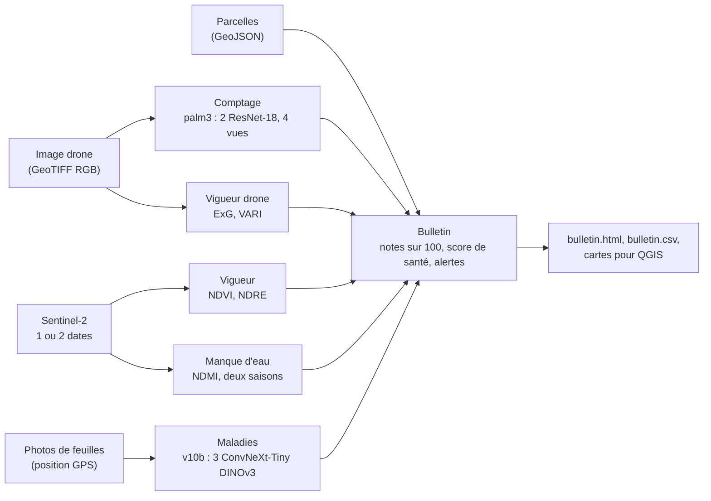
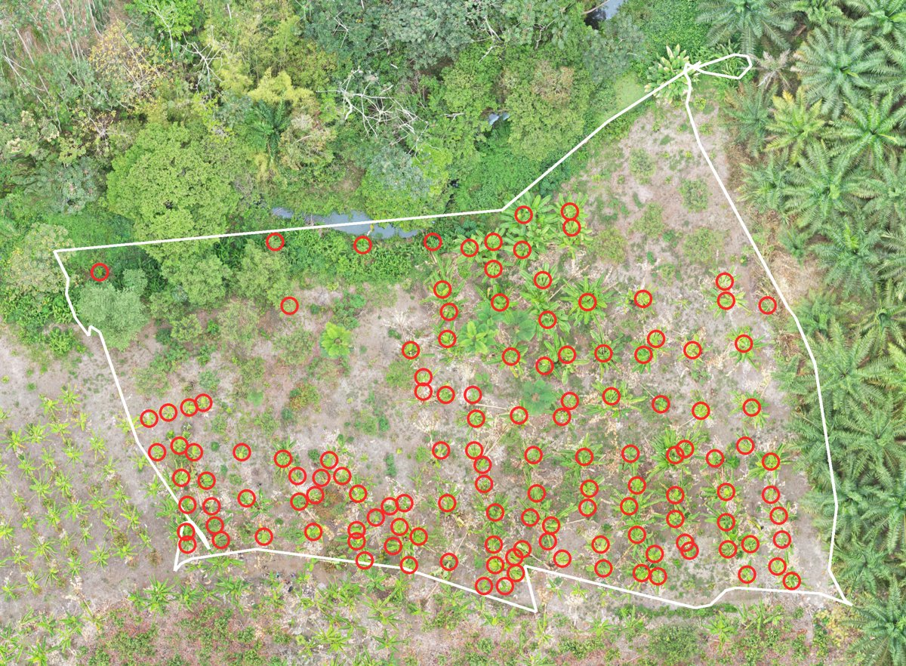
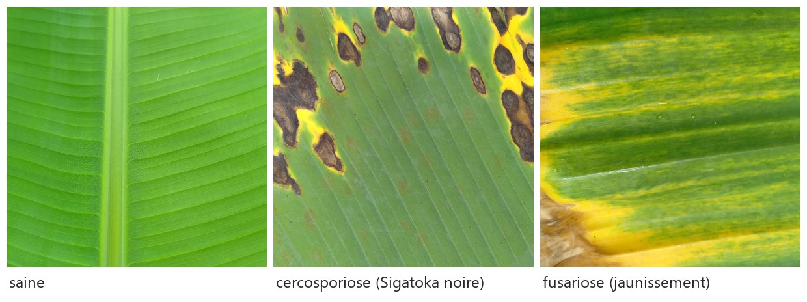
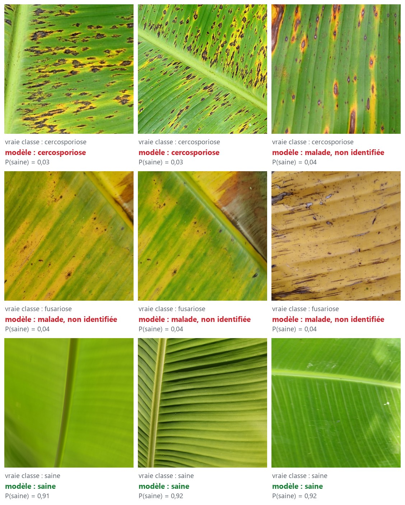

# Field Scan

Field Scan regarde une bananeraie d'en haut et sort un bulletin de santé, parcelle par parcelle. Il compte les pieds sur une image drone, mesure la vigueur et le manque d'eau avec Sentinel-2, et repère les maladies sur des photos de feuilles. Tout tourne sur un PC, sans GPU et sans internet.

Projet piscine Intelligence Lab, ECE.

## Le projet

Un planteur veut savoir, pour chaque parcelle : combien de pieds il a, lesquels poussent mal, où l'eau manque, et si une maladie arrive. Aller voir chaque bananier prend des jours. Field Scan part de ce qu'on peut photographier vite : un vol de drone, deux images satellite gratuites, et quelques photos de feuilles prises au sol avec un téléphone.

Il en sort un bulletin : une carte, une note sur 100 par parcelle, et une liste d'alertes, chacune avec l'image qui la justifie. Le planteur voit tout de suite quelles parcelles aller voir en premier.

J'ai fait deux choix au départ :
- **chaque brique marche seule.** Sans image drone, pas de comptage, mais le reste tourne. Sans photo de feuille, pas de maladies ;
- **une maladie ratée coûte plus cher qu'une fausse alerte.** Une fausse alerte fait faire un détour au planteur. Une Sigatoka ou une fusariose ratée peut lui coûter la parcelle.

## Comment ça marche



- **Comptage** : un détecteur de centres. Le réseau dessine une carte où chaque cœur de bananier fait un pic, puis je garde les pics au-dessus de 0,25. L'image est d'abord remise à 5 cm par pixel, et je fais la moyenne de 2 réseaux sur 4 vues (l'image tournée et retournée). Un pied vu sur deux images qui se recouvrent ne compte qu'une fois.
- **Vigueur** : une zone est faible quand son indice est sous 80 % du niveau normal de la plantation (75e centile). Pour une image drone sans infrarouge, j'utilise la part de végétation (ExG).
- **Eau** : une zone manque probablement d'eau quand son NDMI est plus bas de plus de 0,05 que ce qu'on attend pour sa quantité de feuillage. Avec deux dates, une parcelle est signalée si son NDMI baisse de plus de 0,05 de plus que les autres entre la saison humide et la saison sèche.
- **Maladies** : la moyenne de 3 réseaux sur 4 vues donne une probabilité par classe (saine, cercosporiose, fusariose, autre). Une feuille n'est dite saine que si le modèle en est assez sûr (P(saine) d'au moins 0,519). Sinon, c'est « je ne sais pas », et ça donne une alerte.

## Les modèles et leurs résultats

Je règle les modèles sur la validation, je les compare sur des « juges » (des jeux qu'ils n'ont jamais appris), et chaque test n'est noté qu'une fois. Le journal complet de tous les essais est dans [docs/experiences.md](docs/experiences.md).

### Comptage des pieds : palm3

Un détecteur de centres (ResNet-18 et un décodeur), appris sur des bananeraies, de jeunes plantations, du plantain et des palmiers à huile. Les palmiers lui apprennent à ne pas les prendre pour des bananiers.

| Jeu | Ce que c'est | F1 | Erreur de compte |
|---|---|---|---|
| Validation | plantations du même type que l'apprentissage | 0,800 | |
| Juges | deux types de plantation jamais appris | 0,758 | |
| Nestor (test) | ferme mélangée, Équateur | 0,770 | +20,0 % |
| `segmento` (test) | bananeraie dense | 0,778 | −5,5 % |
| Photos DJI (test) | jeune plantation, pieds mères | 0,767 | −10,6 % |
| banavista et jorges (test) | bananeraies denses, 7 champs | 0,784 | −9,7 % (de −38 % à +31 % selon le champ) |
| Palmiers à huile | aucun bananier | 1,1 faux bananier par hectare | |

La F1 compte une détection juste si elle tombe à moins de 1 m du cœur d'un vrai bananier.


*palm3 sur la parcelle de Manuel (ReforesTree, Équateur) : 132 pieds détectés, en rouge. Quelques détections tombent dans la forêt, en haut à gauche. Manuel a servi à la validation, et le modèle final l'a apprise : c'est une démo, pas un test.*

### Maladies des feuilles : v10b avec la règle B

3 ConvNeXt-Tiny aux poids DINOv3, appris sur 6 sources de 5 pays (Tanzanie, Pérou, Bangladesh, Inde, Ouganda), lus en 384 px.

| Jeu | Malades ratées | Saines en alerte | Sigatoka nommée |
|---|---|---|---|
| Juges (khadavy de près et BDR) | 0,45 % | 0 % | 47,9 % |
| BanSpot, Inde (test) | 0,93 % | 10,2 % | |
| AgroVisionBD, Bangladesh (test) | 1,26 % (9 sur 716) | 15,3 % | 26,8 % |

Elle rate très peu de malades, même dans des pays qu'elle n'a jamais vus : sur AgroVisionBD, 2 Sigatoka ou fusarioses ratées sur 468. En échange, elle alerte sur des feuilles saines mais abîmées (trous d'insectes, déchirures), et elle nomme rarement la maladie.


*Ce que le modèle apprend à reconnaître, en gros plan : une feuille saine, la cercosporiose (Sigatoka noire, des taches brunes cernées de jaune) et la fusariose (la feuille jaunit par le bord). Photos de Tanzanie 2023 (CC0), qui font partie de l'apprentissage.*


*9 gros plans du Bangladesh (AgroVisionBD, un jeu de test que le modèle n'a jamais appris), recadrés sur la feuille avant de lancer le modèle : il lit exactement l'image affichée. Les 6 feuilles malades ont toutes une alerte, et les 3 saines sont dites saines. La cercosporiose est nommée 2 fois sur 3. Les fusarioses restent « malade, non identifiée » : le modèle voit la maladie, mais il n'est pas assez sûr du nom pour le donner. Script : [`preuves/maladies_planche/`](preuves/maladies_planche/).*

### Ce qui n'a pas marché

Du 12 au 14/11, j'ai fait plus de 40 essais pour battre ces deux modèles : réseaux réappris avec plus de données, ensembles, seuils réglés par champ, lecture par morceaux, et d'autres. Aucun ne fait mieux de façon sûre. La raison principale : mes jeux de validation ne prédisent pas les juges. Ce qui gagne en validation retombe souvent ensuite. Le détail est dans [docs/experiences.md](docs/experiences.md).

## Installation

Python 3.10 ou plus récent.

```
git clone https://github.com/Mace-Erwan/Field-Scan-intelligence-lab.git
cd Field-Scan-intelligence-lab
pip install -r requirements.txt
```

Tout tourne sans GPU. Les poids des modèles sont dans `modeles/` (16 bits). Dans un environnement Python vide, l'installation prend environ 7 minutes. Sous Windows, place l'environnement dans un dossier au chemin court : torch ne s'installe pas au-delà de 260 caractères.

## Utilisation

```
python run.py --images DOSSIER --parcelles parcelles.geojson --out resultats/
```

`DOSSIER` peut contenir, dans n'importe quels sous-dossiers :

- **des images drone** géoréférencées (GeoTIFF RGB, pixel de moins de 1 m) : comptage des pieds, et vigueur (ExG, VARI) s'il n'y a pas d'image Sentinel-2 ;
- **des bandes Sentinel-2** exportées du Copernicus Browser (un fichier par bande, avec la date et le nom de la bande dans le nom du fichier, par exemple `2025-12-16-00_00_..._B04_(Raw).tiff`, plus la carte `Scene_classification_map`), pour une ou deux dates : vigueur (NDVI, NDRE) et stress hydrique (NDMI, et comparaison des deux saisons) ;
- **un dossier `feuilles`** avec des photos de feuilles de bananier : maladies (saine, cercosporiose (Sigatoka), fusariose à confirmer par une coupe du pseudo-tronc, maladie non identifiée, ou « je ne sais pas »). Une photo qui a une position GPS est rattachée à sa parcelle.

Chaque partie ne tourne que si ses images sont présentes. `parcelles.geojson` contient les polygones des parcelles (une colonne `id`, créée si elle manque).

Sorties dans `resultats/` :

| Fichier | Contenu |
|---|---|
| `bulletin.html` | carte des parcelles colorées par score de santé, pieds détectés, alertes avec leur image source, tableau ; s'ouvre dans un navigateur, sans internet |
| `bulletin.csv` | une ligne par parcelle : priorité, mesures, notes, score de santé, alertes |
| `pieds.geojson` | un point par pied détecté (parcelle, score) |
| `alertes.geojson` | zones et parcelles signalées, avec le message et l'image source (une alerte par feuille malade) |
| `vigueur.tif`, `stress.tif` | NDVI de la date la plus récente ; écart du NDMI à ce qu'on attend pour la quantité de feuillage (négatif = manque d'eau) |
| `ndvi_<date>.tif`, `ndre_<date>.tif`, `ndmi_<date>.tif` | indices Sentinel-2, pour chaque date |
| `exg_<image>.tif`, `vari_<image>.tif` | indices de l'image drone (cases de 50 cm) |
| `feuilles.csv` | réponse du modèle pour chaque photo de feuille |
| `apercus/` | images sources des alertes |

Toutes les cartes s'ouvrent dans QGIS.

## Comment le bulletin est calculé

- **Vigueur** : une zone est faible si elle l'est face à la plantation (sous 80 % de son niveau normal), ou face au reste de sa propre parcelle (même règle avec le niveau de la parcelle). La note vigueur est la part de la parcelle qui n'est faible pour aucune des deux règles.
- **Eau** : la note est la part de la parcelle qui ne manque pas d'eau.
- **Maladies** : la note dépend de la gravité. 100 si toutes les feuilles photographiées sont saines, 75 s'il n'y a que des « je ne sais pas » (à vérifier), et sous 70 dès qu'une feuille est malade (65 × la part des feuilles non malades).
- **Score de santé** : la pire des notes. Le plus gros problème de la parcelle décide de sa couleur : une parcelle malade ne peut pas être « rattrapée » par une bonne vigueur. Vert à 85 et plus, orange de 70 à 84, rouge sous 70.
- **Alertes** : une note sous 70 déclenche une alerte, comme chaque feuille malade, ou une parcelle dont l'eau baisse plus que les autres entre les saisons.
- **Réponse du modèle pour une feuille** : une feuille est malade si 1 − P(saine) atteint 0,725. La maladie est nommée si elle fait au moins 0,79 de cette part, sinon c'est « maladie non identifiée ». Un « je ne sais pas » avec 1 − P(saine) d'au moins 0,675 devient aussi « maladie non identifiée ».
- **Comptage** : le seuil de 0,25 équilibre fausses détections et oublis, pour que le nombre de pieds par parcelle soit juste. Une image dont les pieds sont espacés de moins de 1,3 m ou de plus de 4,5 m en médiane donne un avertissement : sa taille de pixel est sans doute fausse.

## Ce que le système sait faire, et ses limites

- **Comptage** : bananeraies et fermes mélangées vues du dessus, de préférence à 5 à 8 cm par pixel. Plus haut, la F1 tient encore, mais le modèle oublie de plus en plus de plants : à 11 cm par pixel, il sous-compte de 19 à 51 % les plantations jamais apprises (test du 14/11 dans `docs/experiences.md`). Sa F1 tient autour de 0,77 à 0,78 sur tous les types de plantation testés. Le compte par champ, lui, varie beaucoup : de −38 % à +31 % sur banavista. Il oublie des plants dans les champs très serrés, et environ un jeune plant sur quatre. Un rejet collé à sa mère n'est pas compté à part. L'agroforesterie n'a pas été testée.
- **Maladies** : photos de feuilles prises au sol, de près (pas les images drone). Peu de malades passent sans alerte (0,9 % sur BanSpot, 1,3 % sur AgroVisionBD). En échange, 10 à 15 % des feuilles saines reçoivent une alerte, le plus souvent des feuilles trouées ou déchirées. Le modèle nomme la Sigatoka sur 27 % des feuilles atteintes d'AgroVisionBD, et une Sigatoka légère sur une feuille entière lui échappe encore souvent.
- **Vigueur et stress** : jugés par rapport au reste de la plantation analysée, pas avec des seuils fixes. Je n'ai pas de vérité terrain pour les noter. Sur une ferme mélangée vue par un drone RGB, la vigueur n'est pas calibrée : le sol nu entre les plants la fait paraître faible.
- **Temps de calcul** (sans GPU) : environ 1 min 40 par hectare d'image drone pour le comptage sur un processeur à 2 cœurs, et environ 3 s par photo de feuille. Sur mon PC, une orthomosaïque entière de 858 Mo (1 cm par pixel, 1,55 ha de plantation) passe en 4 min 29 s de bout en bout, dont 110 s par hectare pour le comptage ; la démo du Cameroun prend 32 s.
- **Formats d'entrée testés** (16/11) : parcelles en GeoJSON ou GeoPackage, dans n'importe quelle projection, avec ou sans colonne `id`, multipolygones et contours qui se recoupent ; Sentinel-2 à une ou deux dates, bandes nommées `B04.tiff` ou à la manière du Copernicus Browser, date dans le nom du fichier ou du dossier (`2025-12-16`, `20251216`) ; bandes B11 ou B12 absentes (le stress hydrique est alors sauté) ; drone en degrés ou en mètres ; photos JPEG ou PNG, avec ou sans GPS ; chemins avec espaces et accents. Un dossier vide donne un message clair.

## Contenu du dépôt

- `run.py` : la chaîne d'analyse (commande ci-dessus).
- `entrees.py` : trouve les images drone, les bandes Sentinel-2 et les photos de feuilles ; lit les parcelles.
- `comptage/` : `detecteur.py` (modèle de comptage), `pieds.py` (comptage sur une image géoréférencée), `evaluation.py` (notation à 1 m), `baseline_exg.py` (méthode classique ExG + maxima locaux).
- `maladies/classifieur.py` : modèle maladies (préparation des photos, décision).
- `indices/` : `sentinel2.py` (lecture des bandes, nuages), `vigueur.py`, `stress.py`.
- `bulletin/` : `bulletin.py` (notes, alertes, page HTML), `apercus.py` (images des alertes et fond de carte).
- `modeles/` : poids des modèles (16 bits) et seuils (`modeles/maladies/seuils.json`).
- `entrainement/` : notebooks d'entraînement (Kaggle, Colab). Les modèles installés viennent de `comptage_palm3_final_kaggle.ipynb` et `maladies_v10b_kaggle.ipynb`.
- `outils/` : scripts de préparation et de vérification des données, et `evaluer_comptage.py`, qui note un modèle de comptage.
- `docs/carnet_donnees.md` : carnet de données (sources, licences, découpage, risques de fuite, biais).
- `docs/experiences.md` : journal de tous les essais et résultats.
- `docs/rapport.md` : rapport du projet (choix, comparaisons, erreurs, limites).
- `preuves/` : les scripts et les résultats bruts des mesures citées dans le journal (test unique du comptage, image moins fine, seuil variable, tests de robustesse, essais maladies, apport de chaque bande).

Les données ne sont pas dans le dépôt : leurs sources sont décrites dans le carnet de données.

## Mentions

- Les modèles de maladies utilisent les poids DINOv3 : Built with DINOv3.
- Les cartes Sentinel-2 : Contains modified Copernicus Sentinel data 2025, 2026.
- Les photos de feuilles du bulletin viennent d'AgroVisionBD (CC BY 4.0), les gros plans de Tanzanie 2023 (CC0). La parcelle de Manuel vient de ReforesTree (CC BY 4.0).
