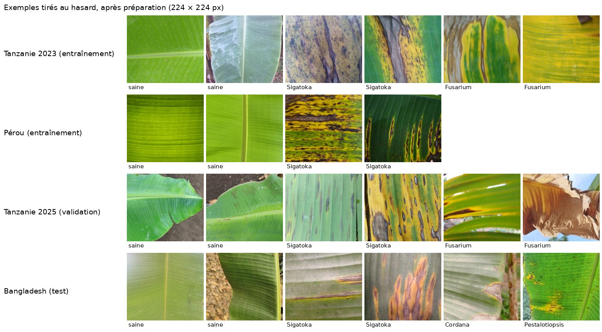
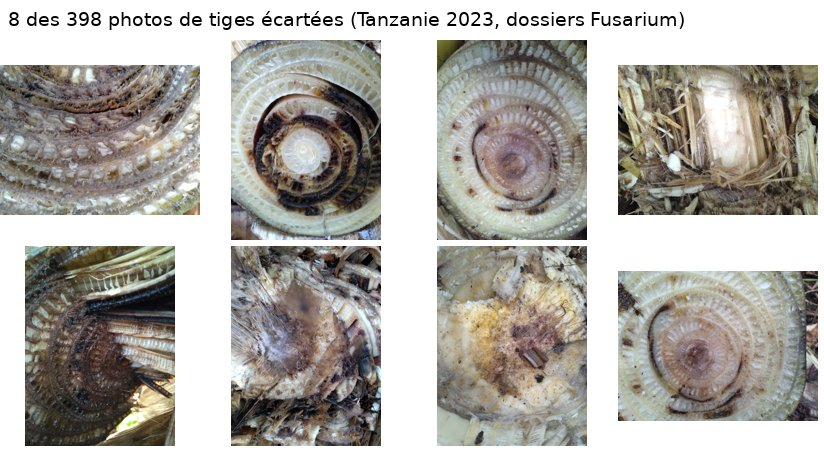
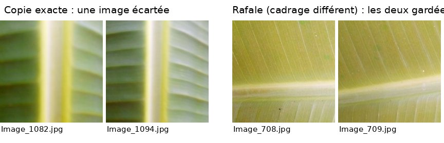
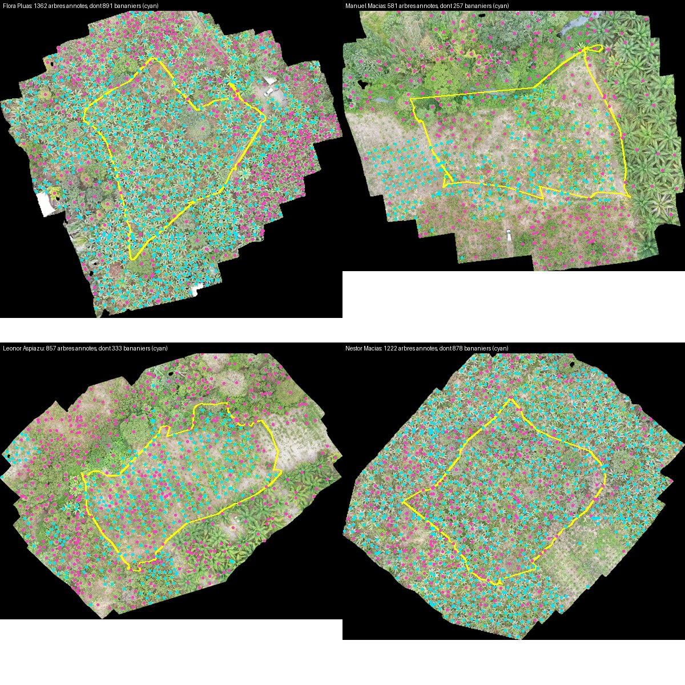
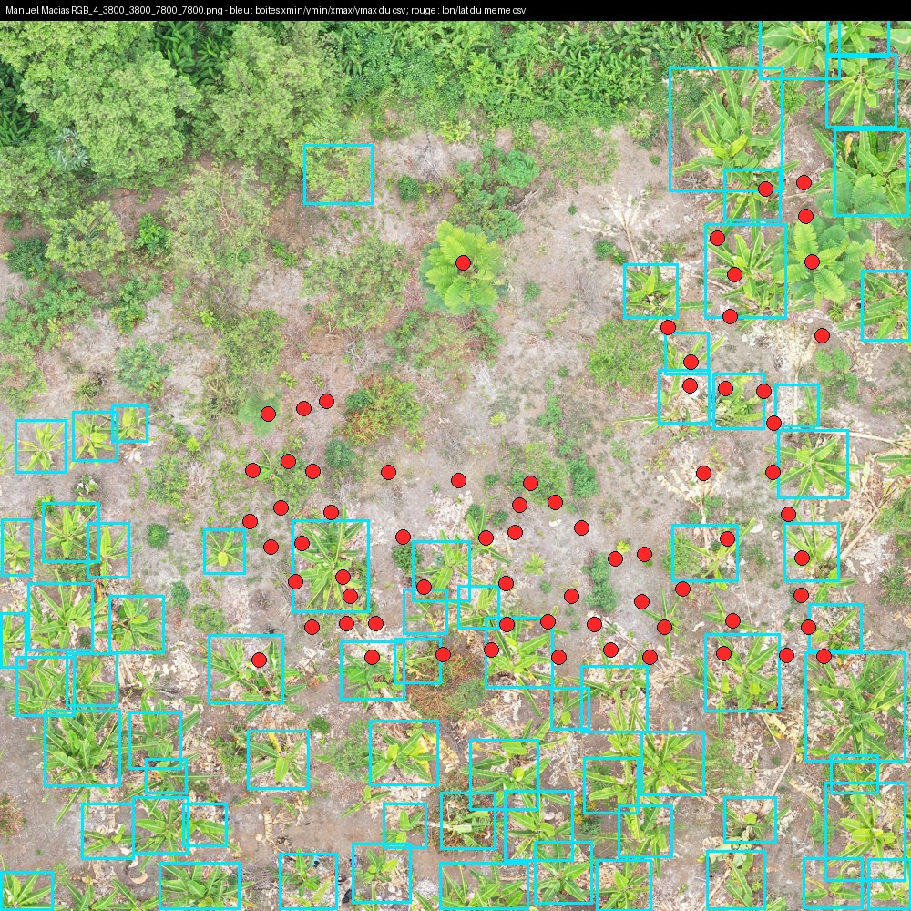
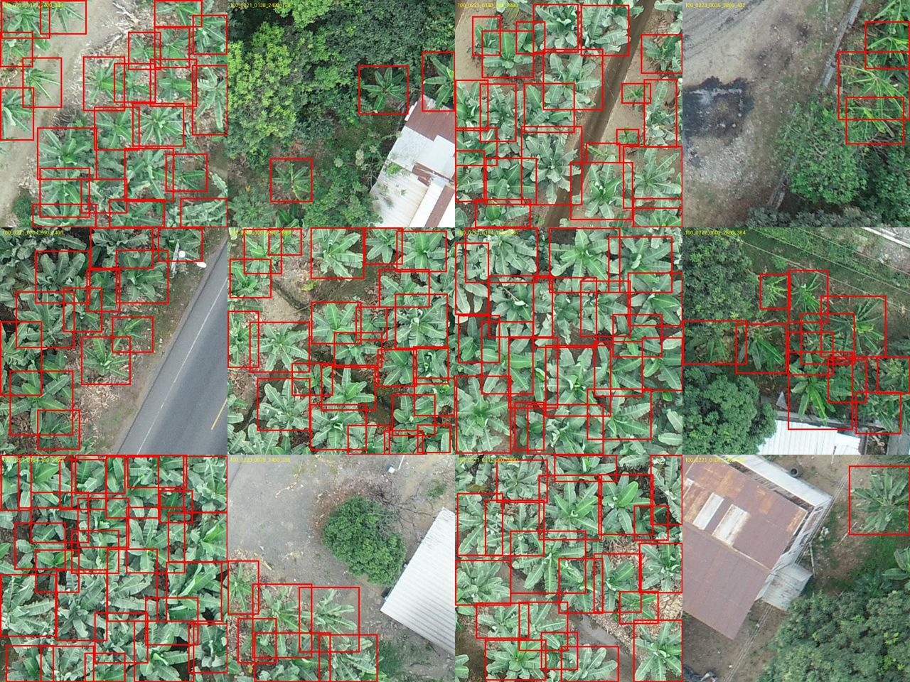

# Carnet de données — Field Scan

Mis à jour le 05/11/2026.

## Vue d'ensemble des photos de feuilles

| Rôle | Jeu | Photos utilisées |
|---|---|---|
| Entraînement | Tanzanie 2023 (section 1) + Pérou (section 9) | 15 691 + 1 268 |
| Validation | Tanzanie 2025 (section 2) | 11 766 |
| Test | Bangladesh (section 3) | 893 |

*Photos tirées au hasard dans chaque jeu, après préparation. Les cadrages et les couleurs changent d'un jeu à l'autre : gros plans en 2023, feuilles plus entières avec du fond en 2025, couleurs plus ternes au Bangladesh.*

## 1. Feuilles de bananier — Tanzanie 2023 (Harvard Dataverse)

- **Provenance** : Mduma & Leo, *Dataset of banana leaves and stem images for object detection, classification and segmentation: A case of Tanzania*, Data in Brief 49 (2023) 109322, [DOI 10.1016/j.dib.2023.109322](https://doi.org/10.1016/j.dib.2023.109322). Données sur [Harvard Dataverse](https://dataverse.harvard.edu/dataset.xhtml?persistentId=doi:10.7910/DVN/LQUWXW), téléchargées le 18/10/2026. Photos prises dans les régions de Kagera, Arusha, Dar es Salaam, Kilimandjaro et Mbeya.
- **Licence** : CC0 1.0 (domaine public).
- **Résolution** : smartphones Samsung 13 Mpx, photos prises au sol. Les images fournies sont réduites : 1024 × 768 px pour la plupart (en paysage ou en portrait), avec une partie en 640 × 480 px dans FUSARIUM WILT_1 et en 640 × 288 px dans HEALTHY_1 (sondage de 200 images par dossier).
- **Date d'acquisition** : février à juillet 2021 d'après l'article. Les métadonnées des photos (EXIF) donnent une date pour 12 456 des 16 092 images : du 18/03 au 12/04/2021. Les 6 175 photos qui ont une position GPS ont toutes été prises autour d'Arusha, et toutes par le même téléphone (Samsung SM-A015F).
- **Composition** : 16 092 images après suppression des doublons : 5 628 saines, 5 767 Black Sigatoka, 4 697 Fusarium Wilt Race 1. Ce sont les chiffres de l'article, que j'ai retrouvés exactement en comptant les fichiers ; la fiche descriptive fournie avec les données (17 068 images) décrit l'état avant suppression des doublons. Les dossiers « sain » ne contiennent que des feuilles ; d'après l'article, les dossiers malades contiennent des feuilles et des tiges. Les images sont nommées `Image_<numéro>.jpg`, sans indication de feuille ou de tige. Je ne garde que les feuilles, puisque le sujet porte sur la classification de feuilles : le tri se fera donc sur le contenu des images. Les archives contiennent aussi des fichiers système macOS (`__MACOSX`, `.DS_Store`), que j'ignore.
- **Découpage** : entraînement du modèle maladies.
- **Risques de fuite** : ce jeu vient de la même équipe que le jeu Tanzanie 2025, avec des régions en commun (Arusha, Mbeya). Les mêmes fermes, voire les mêmes plants, peuvent apparaître dans les deux. J'ai recherché les doublons entre les deux jeux : je n'en ai trouvé aucun (détail en section 2). La fiche descriptive précise aussi que quelques doublons et des images très proches peuvent subsister à l'intérieur du jeu. Ma recherche de doublons (méthode en section 2) en trouve 31 paires : surtout des rafales (même feuille, cadrage à peine différent), que je garde puisqu'elles restent dans le même jeu, et 3 copies exactes, que j'écarte (`outils/listes/doublons_tanzanie.txt`).
- **Biais et limites** :
    - les tiges n'apparaissent que dans les classes malades ; sans tri, un modèle pourrait apprendre « tige = malade ». J'ai regardé 40 images tirées au hasard dans chacun des 6 dossiers : je n'ai trouvé des tiges que dans Fusarium, et aucune dans les 80 images Black Sigatoka. J'ai ensuite passé en revue à l'œil, sur des planches de vignettes, toutes les images Fusarium et Black Sigatoka : 318 tiges (317 Fusarium et une seule Black Sigatoka, `BLACK SIGATOKA_2/Image_6450.jpg`), toutes des coupes du pseudo-tronc ou du bulbe, faciles à reconnaître (forme ronde ou fibres, anneaux bruns sur fond blanc). Pour vérifier ce tri, j'ai ensuite classé automatiquement les 30 064 photos de tous les jeux de feuilles selon leur ressemblance avec 6 photos de tiges et 42 photos de feuilles (`outils/reperer_tiges.py`, réseau EfficientNet-B0 pré-entraîné), et j'ai regardé les 411 premières. Ce classement a trouvé 80 tiges que j'avais manquées, sur une planche sautée (`FUSARIUM WILT_1/Image_1949` à `Image_2032`), et aucune tige dans les autres jeux (Tanzanie 2025, Pérou, Bangladesh). J'écarte donc 398 images de tiges (liste dans `outils/listes/tiges_tanzanie_2023.txt`). Avec les 3 copies exactes, il reste 15 691 images de feuilles : 5 627 saines, 5 766 Black Sigatoka et 4 298 Fusarium. Le déséquilibre « tige = Fusarium » est donc le vrai risque de ce jeu ;
    - certains formats d'image n'existent que dans une classe (640 × 288 px chez les saines, 640 × 480 px chez Fusarium) : toutes les images sont ramenées à 224 × 224 px (`outils/preparer_feuilles.py`), pour que le modèle ne puisse pas s'en servir ;
    - cadrage : gros plans qui remplissent presque toute l'image, avec très peu de fond. Les feuilles saines montrent souvent la nervure centrale ;
    - lumière : photos de jour. Une partie des images Black Sigatoka a une teinte violette ou bleutée, sans doute un réglage des couleurs du téléphone ;
    - chaque classe a été photographiée à des jours différents (métadonnées EXIF) : saines du 18 au 25 mars, Black Sigatoka surtout du 26 au 30 mars, Fusarium du 2 au 12 avril 2021. Un modèle pourrait apprendre la lumière ou le champ d'un jour plutôt que la maladie : c'est une raison de plus pour valider et tester sur d'autres jeux ;
    - un seul pays, une seule région (Arusha) pour les photos géolocalisées.

*8 des 398 photos de tiges écartées : coupes de pseudo-tronc ou de bulbe, rangées avec les feuilles dans les dossiers Fusarium.*

## 2. Feuilles de bananier — Tanzanie 2025 (Zenodo)

- **Provenance** : Mduma & Elinisa, *Banana Leaves Imagery Dataset*, Scientific Data (2025), [DOI 10.1038/s41597-025-04456-4](https://doi.org/10.1038/s41597-025-04456-4). Données sur [Zenodo](https://doi.org/10.5281/zenodo.7670326), téléchargées le 18/10/2026. Photos prises dans les districts de Rungwe, Mbeya, Arumeru et Arusha.
- **Licence** : CC BY 4.0.
- **Résolution** : smartphone, 4624 × 3468 px pour la grande majorité des images (sondage de 200 images par dossier), quelques images recadrées.
- **Date d'acquisition** : novembre 2022 à janvier 2023 (article) ; les métadonnées des photos vont du 22/11/2022 au 20/01/2023. Autre téléphone que pour 2023 (Samsung SM-A715F), pas de position GPS.
- **Composition** : 11 767 images de feuilles (3 339 saines, 3 496 Black Sigatoka, 4 932 Fusarium Wilt Race 1), réparties en 9 archives, 3 par classe. Au départ, je n'en avais téléchargé qu'une par classe (`HEALTHY-1`, `BLACK SIGATOKA-1`, `FUSARIUM WILT-1`, 3 001 images). Je les utilise maintenant toutes : une validation plus grande rend le choix des seuils plus fiable. Après retrait d'une copie exacte (`HEALTHY-2/HEALTHY_1926.jpg`), il reste 11 766 images.
- **Découpage** : validation du modèle maladies.
- **Risques de fuite** : voir Tanzanie 2023. La séparation entre les deux jeux est temporelle (2021 contre 2022-2023), pas géographique. Je recherche les doublons sur tous les jeux de feuilles à la fois (`outils/preparer_feuilles.py`) : empreinte d'image (au plus 4 bits de différence), puis deux confirmations en comparant les images réduites (32 × 32 px en couleur, puis 112 × 112 px en gris, corrélation d'au moins 0,9), puis vérification à l'œil. La 2e confirmation est nécessaire : sans elle, la méthode signalait 4 356 paires, presque toutes fausses, parce que deux feuilles différentes ont souvent la même texture uniforme. Avec elle, il reste 81 paires : 42 dans le Bangladesh, 31 dans Tanzanie 2023, 5 dans le Pérou, 3 dans Tanzanie 2025, et **aucune entre deux jeux différents**. Je n'écarte que les copies exactes (mêmes détails aux mêmes endroits) ; les rafales restent, puisqu'elles sont dans le même jeu. Cette méthode repère les copies d'une même photo ; elle ne garantit pas qu'une même feuille n'a pas été photographiée à nouveau sous un autre angle.
- **Biais et limites** :
    - même pays et même équipe que le jeu d'entraînement, donc des scores de validation probablement optimistes. C'est pour cette raison que je teste sur un autre pays ;
    - cadrage différent du jeu 2023 : feuilles souvent entières, avec du fond (sol, autres plants, ciel), et non des gros plans. Le modèle sera donc validé sur des images qui ne ressemblent pas tout à fait à son entraînement ;
    - comme en 2023, chaque classe a surtout été photographiée à des jours différents (métadonnées EXIF, toutes les photos sont datées) : saines les 22 et 23/11/2022 (2 224 photos) puis du 16 au 18/01/2023 (1 115), Fusarium du 6 au 22/12/2022 (4 344) puis du 18 au 20/01/2023 (588), Black Sigatoka les 12 et 13/01/2023 (3 422) puis les 18 et 20/01 (74). Seul le 18/01/2023 réunit les trois classes. Le biais « classe = jour » existe donc aussi dans la validation ;
    - dans un échantillon de 24 images par classe, des tuyaux d'irrigation bleus apparaissent derrière 3 feuilles saines, et jamais dans les autres classes : un modèle pourrait associer ce décor à la classe saine ;
    - dans ce même échantillon, 2 feuilles étiquetées saines portent des taches brunes (`HEALTHY_453.jpg`, `HEALTHY_486.jpg`) : il peut y avoir des erreurs d'étiquetage.

*À gauche, une copie exacte trouvée dans Tanzanie 2023 : une des deux images est écartée. À droite, une rafale (même feuille, cadrage à peine différent) : les deux restent, puisqu'elles sont dans le même jeu.*

## 3. Feuilles de bananier — Bangladesh, BananaLSD (Mendeley Data)

- **Provenance** : Arman et al., *BananaLSD: A banana leaf images dataset for classification of banana leaf diseases using machine learning*, Data in Brief (2023) 109608, [DOI 10.1016/j.dib.2023.109608](https://doi.org/10.1016/j.dib.2023.109608). Données sur [Mendeley Data](https://data.mendeley.com/datasets/9tb7k297ff/1), téléchargées le 18/10/2026. Photos prises dans les champs de la Bangabandhu Sheikh Mujibur Rahman Agricultural University et les champs voisins, à Gazipur.
- **Licence** : CC BY 4.0.
- **Résolution** : 3 smartphones, lumière naturelle ; images fournies en 224 × 224 px.
- **Date d'acquisition** : juin 2021.
- **Composition** : 937 photos originales (473 sigatoka, 173 pestalotiopsis, 162 cordana, 129 saines), étiquetées par un phytopathologiste. Vérifié après décompression. Le dépôt contient aussi 1 600 images augmentées, copies modifiées des originales : je ne les utilise pas.
- **Découpage** : test sur un autre pays. Les classes cordana et pestalotiopsis, jamais vues à l'entraînement, servent à tester la réponse « je ne sais pas ».
- **Risques de fuite** : aucune source commune avec les jeux tanzaniens (autre pays, autre équipe). Les images augmentées sont exclues, car elles feraient compter plusieurs fois la même photo.
- **Biais et limites** : petit jeu (937 images), déséquilibré (473 sigatoka contre 129 saines), un seul site, un seul mois. Pas de Fusarium. Le type de Sigatoka (noire ou jaune) n'est pas précisé. Cadrage proche de Tanzanie 2023 (gros plans), avec des couleurs plus ternes. Le jeu contient des doublons, que j'ai recherchés automatiquement (`outils/preparer_feuilles.py`) puis vérifiés à l'œil : 42 groupes d'images identiques ou presque. 38 concernent la classe saine, ce qui ramène les 129 photos saines à environ 90 photos distinctes. Une même photo apparaît aussi deux fois avec deux étiquettes différentes (`healthy/122.jpg` et `pestalotiopsis/78.jpg`). Je retire 44 images du test (liste dans `outils/listes/doublons_bangladesh.txt`) : une seule image est gardée par groupe, et les deux images à l'étiquette contradictoire sont écartées. Il reste 893 images de test : 90 saines, 472 sigatoka, 159 cordana, 172 pestalotiopsis. Les images sont déjà en 224 px alors que les jeux tanzaniens sont en haute résolution : toutes les images des trois jeux sont ramenées à 224 × 224 px, pour que le modèle ne puisse pas reconnaître un jeu à sa résolution.

## 4. Images drone — ReforesTree, Équateur (Zenodo)

- **Provenance** : Reiersen et al., *ReforesTree: A Dataset for Estimating Tropical Forest Carbon Stock with Deep Learning and Aerial Imagery*, AAAI 2022, [arXiv:2201.11192](https://arxiv.org/abs/2201.11192). Données sur [Zenodo](https://zenodo.org/records/6813783), téléchargées le 18/10/2026. Six fermes de cacao en agroforesterie : Carlos Vera Arteaga, Carlos Vera Guevara, Flora Pluas, Leonor Aspiazu, Manuel Macias, Nestor Macias, en deux groupes distants d'environ 110 km (Flora et Nestor au sud, près de Milagro ; les quatre autres au nord, près de Mocache).
- **Licence** : CC BY 4.0.
- **Résolution** : drone Mavic 2 Pro, caméra RGB, vol à 40 m. Une orthomosaïque par ferme, de 0,97 à 1,19 cm par pixel selon la ferme (fichiers `.tfw`), erreur de positionnement de 0,25 à 0,69 m. Je réduis les images 4 fois pour travailler plus vite : 3,9 à 4,8 cm par pixel selon la ferme.
- **Date d'acquisition** : 27 et 28 octobre, probablement 2020 (rapport de vol daté du 1.11.2020).
- **Composition** : chaque arbre est annoté par une boîte autour de sa couronne, étiquetée bananier ou non (`annotations/cleaned/clean_annotations.csv`, 7 969 boîtes). Les auteurs ont annoté sur des tuiles qui se chevauchent, sans fusionner les doublons : un même arbre a souvent deux boîtes, et toutes celles d'Arteaga sont en double. Je fusionne les boîtes d'une même ferme qui se recouvrent à plus de 50 % (`outils/preparer_reforestree.py`) : il reste 5 328 arbres, dont 2 731 bananiers. Les boîtes couvrent toute l'orthomosaïque, mais certaines zones hors des parcelles n'en ont aucune (par exemple le bord droit de Manuel, image ci-dessous). Chaque ferme a une **parcelle** inventoriée sur le terrain (shapefile `Merged_final_plots`) : je ne garde que l'intérieur. Dans les parcelles :

| Ferme | Surface | Arbres | Bananiers | Part de bananiers |
|---|---|---|---|---|
| Flora Pluas | 0,40 ha | 335 | 291 | 87 % |
| Leonor Aspiazu | 0,48 ha | 331 | 220 | 66 % |
| Carlos Vera Guevara | 0,43 ha | 319 | 52 | 16 % |
| Carlos Vera Arteaga | 0,53 ha | 137 | 58 | 42 % |
| Manuel Macias | 0,41 ha | 190 | 133 | 70 % |
| Nestor Macias | 0,45 ha | 389 | 235 | 60 % |

*Quatre fermes en entier. En jaune la parcelle inventoriée, en cyan les bananiers annotés, en rose les autres arbres annotés (un point = le centre d'une boîte).*

- **Position des arbres** : le fichier donne pour chaque arbre sa boîte (`xmin`, `ymin`, `xmax`, `ymax` dans la tuile, `X`, `Y` pour son centre dans l'orthomosaïque) et une longitude-latitude (`lon`, `lat`). **Les colonnes `lon`, `lat` sont fausses sur 5 fermes sur 6** : elles sont calculées à partir de `X`, `Y` avec une mauvaise taille de pixel (par exemple 0,74 cm au lieu de 1,13 cm pour Manuel, 0,52 cm au lieu de 0,97 cm pour Flora). Les points sont donc tassés vers le coin de l'image, à environ 20 m de leur boîte en moyenne (17 à 21 m selon la ferme). Seule Arteaga est juste (1,03 cm au lieu de 1,04 cm, 1,3 m d'écart). Vérifications : les tuiles sont identiques à l'orthomosaïque au même endroit ; 79 à 98 % des centres de boîtes de bananiers tombent sur de la végétation (plus verte que la médiane de l'image), contre 32 à 56 % des positions `lon`, `lat`, autant qu'au hasard. **J'utilise donc le centre des boîtes** (`X`, `Y`), jamais `lon`, `lat`.

*Une tuile brute de Manuel (environ 1 cm par pixel). En bleu les boîtes de bananiers du fichier, en rouge la longitude-latitude des mêmes bananiers : le même dessin, rétréci et décalé.*

- **Découpage** : par ferme entière. Apprentissage : Flora, Leonor, Guevara, Arteaga. Validation : Manuel. Test : Nestor, que je ne regarde qu'une fois, à la fin. Le comptage est noté uniquement à l'intérieur des parcelles. Pour le comptage, chaque ferme devient une seule image à 5 cm par pixel, recadrée sur sa parcelle avec 2 m de marge, noire hors de la parcelle (`outils/preparer_comptage.py`).
- **Risques de fuite** : les tuiles d'une même ferme se chevauchent ; un découpage au hasard mettrait les mêmes arbres en entraînement et en test, d'où la séparation par ferme. Le modèle DeepForest fourni avec le jeu a été entraîné par les auteurs sur ces mêmes fermes : je ne l'utilise pas.
- **Biais et limites** :
    - fermes de cacao où le bananier est une culture secondaire, mêlée à d'autres arbres, et non une bananeraie ;
    - les boîtes ne distinguent pas pied mère et rejets ;
    - hors des parcelles, certaines zones n'ont aucune boîte ; à l'intérieur des parcelles, je n'ai pas encore vérifié à l'œil que chaque bananier a sa boîte ;
    - Arteaga est très peu dense : 137 arbres dans 0,53 ha, environ 260 par hectare contre environ 840 à Flora. Sa parcelle (contour officiel des auteurs, vérifié) est une zone sèche avec beaucoup de petites plantes non annotées ;
    - Guevara n'a que 52 bananiers dans sa parcelle (16 % des arbres) ;
    - éclairage différent selon les fermes : ciel couvert à Flora, Nestor, Manuel et Leonor, soleil à Arteaga et Guevara ;
    - l'erreur de positionnement (jusqu'à 0,69 m) est proche de la tolérance de 1 m utilisée pour noter.

## 5. Images satellite — Sentinel-2 (Copernicus)

- **Provenance** : [Copernicus Browser](https://browser.dataspace.copernicus.eu/), produits de niveau L2A (corrigés de l'atmosphère), téléchargés le 20/10/2026. Deux bananeraies industrielles dans deux pays, identifiées au préalable sur une imagerie satellite haute résolution :
    - **Équateur**, El Guabo (province d'El Oro) : longitude -79.8463 à -79.8272, latitude -3.1623 à -3.1497 ;
    - **Cameroun**, Njombe-Penja (région du Littoral) : longitude 9.6426 à 9.6502, latitude 4.6213 à 4.6399.
- **Licence** : accès libre et gratuit. Mention obligatoire sur les produits dérivés : « Contains modified Copernicus Sentinel data [année] ».
- **Résolution** : bandes rééchantillonnées à 10 m par pixel au téléchargement (résolution native : 10 m pour B02, B03, B04, B08 ; 20 m pour B05, B8A, B11, B12). Projection UTM 17S (EPSG:32717) pour l'Équateur, UTM 32N (EPSG:32632) pour le Cameroun.
- **Date d'acquisition** : une date par saison et par site.

| Site | Saison des pluies | Saison sèche |
| --- | --- | --- |
| Équateur | 31/03/2026 | 22/09/2026 |
| Cameroun | 20/04/2026 | 16/12/2025 |

- **Composition** : pour chaque date, 8 bandes en réflectance (B02, B03, B04, B05, B08, B8A, B11, B12) et la carte de classification de scène (SCL), qui signale nuages et ombres (téléchargée dans sa version colorée, une couleur par classe). Équateur : 2,95 km² (211 × 138 pixels). Cameroun : 1,73 km² (84 × 205 pixels). Pour chaque site, les deux dates couvrent exactement la même grille de pixels. D'après la SCL, aucun pixel de nuage ni d'ombre dans les quatre images. Ces vérifications sont reproductibles avec `outils/verifier_sentinel2.py`.
- **Découpage** : pas d'apprentissage ; les seuils des cartes de vigueur et de stress hydrique sont réglés sur l'Équateur et évalués sur le Cameroun.
- **Risques de fuite** : aucun entre les sites, situés dans deux pays différents. Au sein d'un site, les deux dates sont comparées entre elles, pas utilisées l'une pour régler l'autre.
- **Biais et limites** :
    - un pixel couvre 10 m, donc plusieurs bananiers à la fois : aucune lecture à l'échelle du plant ;
    - zones très nuageuses : les rectangles ont été placés sur les seuls blocs dégagés aux deux dates, ce qui limite leur taille (en particulier au Cameroun) et peut les rendre peu représentatifs de toute la plantation ;
    - au Cameroun, 9,5 % des pixels sont classés « sol nu » en décembre contre 0,2 % en avril : ces parcelles étaient probablement en cours de replantation et ont été couvertes par la végétation entre les deux dates. Une différence d'indice sur ces parcelles reflète ce changement, pas un manque d'eau : elles seront exclues de la comparaison du stress hydrique ;
    - les deux sites réagissent très différemment aux saisons : en Équateur, l'écart d'indice d'humidité (NDMI) médian entre les deux dates est faible (0,43 contre 0,41), probablement grâce à l'irrigation ; au Cameroun, il est plus marqué (0,34 contre 0,30). Des seuils absolus ne seraient donc pas transposables d'un site à l'autre ;
    - les dates de saison des pluies et de saison sèche sont séparées de 4 à 6 mois : l'état de la plantation (récoltes, replantations) a pu changer entre les deux.

## 6. Parcelles — tracées à la main (QGIS)

- **Provenance** : polygones que j'ai tracés à la main dans QGIS 3.44, sur la bande rouge (B04) des images Sentinel-2 de la section 5 : image du 16/12/2025 pour le Cameroun, du 22/09/2026 pour l'Équateur. Tracé le 20/10/2026 (Cameroun) et le 21/10/2026 (Équateur).
- **Licence** : travail personnel, livré avec le projet. Les polygones sont tracés sur des données Copernicus (mention : « Contains modified Copernicus Sentinel data 2025, 2026 »).
- **Résolution** : précision d'environ un pixel, soit 10 m. Tracé dans la projection de l'image (EPSG:32632 pour le Cameroun, EPSG:32717 pour l'Équateur), puis exporté en GeoJSON en latitude-longitude (EPSG:4326).
- **Date d'acquisition** : celle des images utilisées pour le tracé (voir Provenance).
- **Composition** : deux fichiers, `parcelles_cameroun.geojson` et `parcelles_equateur.geojson`, de 15 polygones chacun, avec un champ `id` de 1 à 15. Surfaces : 2,8 à 4,4 ha par parcelle au Cameroun (50 ha au total), 1,4 à 3,0 ha en Équateur (32 ha au total).
- **Découpage** : comme les images de la section 5 : réglage sur l'Équateur, évaluation sur le Cameroun.
- **Risques de fuite** : aucun car aucun modèle n'est entraîné sur ces parcelles.
- **Biais et limites** :
    - au Cameroun, les limites des parcelles se voient bien sur l'image : les chemins qui les séparent apparaissent comme des lignes claires. J'ai tracé chaque parcelle à l'intérieur de ces chemins ;
    - en Équateur, les limites des lots de la plantation ne se voient pas à 10 m. Les seules lignes visibles sont des couloirs de câbles parallèles, en diagonale, plus fins qu'un pixel : ils apparaissent comme des lignes floues. J'ai donc placé les parcelles au centre des bandes de végétation entre deux couloirs, en coupant chaque bande en plusieurs morceaux. Ces parcelles sont un découpage de ma part, pas les vrais lots de l'exploitation ;
    - en Équateur, l'image paraissait presque noire à l'ouverture, car le toit très clair de l'hacienda écrasait le contraste. J'ai réglé l'affichage (coupe à 2 % et 98 % de l'histogramme) pour voir les couloirs ; ce réglage ne modifie pas les valeurs des pixels ;
    - j'ai évité les routes, l'hacienda et les zones hors bananeraie. Les parcelles ne contiennent donc que l'intérieur de la plantation, sans ses bords. Malgré ces précautions, les pixels en bordure de parcelle peuvent mélanger bananiers et chemins ;
    - avec un pixel de 10 m, une parcelle de 1,4 ha ne contient qu'environ 140 pixels.

## 7. Modèles pré-entraînés

**MobileNetV3-Large (maladies)**

- **Modèle** : poids `IMAGENET1K_V2` de torchvision, pré-entraînés sur ImageNet-1k (1,2 million de photos, 1 000 classes d'objets).
- **Usage** : modèle maladies v1, puis comparaison pour la v2. Je remplace la dernière couche (3 classes : saine, Black Sigatoka, Fusarium), puis j'entraîne tout le réseau sur Tanzanie 2023 et le Pérou (`entrainement/maladies_v2_kaggle.ipynb`).
- **Pourquoi** : réseau léger, conçu pour tourner sans GPU, comme le demande le sujet ; le pré-entraînement évite d'apprendre à partir de zéro avec seulement 16 959 photos.
- **Risque de fuite** : ImageNet ne contient pas les photos de Tanzanie, du Pérou ni du Bangladesh.

**EfficientNet-B0 (maladies, comparaison ; tri des tiges)**

- **Modèle** : poids `IMAGENET1K_V1` de torchvision, pré-entraînés sur ImageNet-1k.
- **Usage** : comparé à MobileNetV3 pour le modèle maladies, avec les mêmes réglages (résultats dans [experiences.md](experiences.md)). Sert aussi, sans réentraînement, à classer les photos selon leur ressemblance à des tiges (`outils/reperer_tiges.py`).

**EfficientNet-B2 et ConvNeXt-Tiny (maladies)**

- **Modèles** : poids `IMAGENET1K_V1` de torchvision, pré-entraînés sur ImageNet-1k. EfficientNet-B2 : 7,7 millions de paramètres ; ConvNeXt-Tiny : 28 millions.
- **Usage** : comparés à MobileNetV3 et EfficientNet-B0, avec la même recette et des photos en 224 × 224 px pour tous. **ConvNeXt-Tiny est le réseau retenu** pour le modèle maladies (moyenne de 3 modèles). Les deux restent utilisables sans GPU.
- **Risque de fuite** : ImageNet ne contient pas les photos de Tanzanie, du Pérou ni du Bangladesh.

**DeepForest (comptage)**

- **Modèle** : détecteur de couronnes d'arbres `weecology/deepforest-tree` (bibliothèque DeepForest 2, réseau RetinaNet), pré-entraîné par ses auteurs sur des images aériennes de forêts, à environ 10 cm par pixel.
- **Usage** : point de départ d'un des deux modèles de comptage. Je le réentraîne sur mes jeux de comptage (ReforesTree, Count banana plants, Plants-bana `segmento` et `corte`) et je le compare au détecteur de centres (`entrainement/comptage_v2_kaggle.ipynb`).
- **Limite** : mes images sont à 5 cm par pixel, deux fois plus fines que celles de son pré-entraînement : les arbres lui paraissent deux fois plus gros.
- **Risque de fuite** : ses données de pré-entraînement ne contiennent pas les fermes ReforesTree.

**ResNet-18 (comptage, détecteur de centres)**

- **Modèle** : poids `IMAGENET1K_V1` de torchvision, pré-entraînés sur ImageNet-1k (11 millions de paramètres).
- **Usage** : base du détecteur de centres. Je garde ses 4 étages et j'ajoute un petit décodeur qui produit une carte : pour chaque carré de 20 cm, la probabilité qu'un centre de bananier s'y trouve (`entrainement/comptage_v2_kaggle.ipynb`).
- **Risque de fuite** : ImageNet est fait de photos prises au sol ; il ne contient pas mes images de drone.

## 8. Images drone — Count banana plants (Roboflow Universe)

- **Provenance** : projet [« Count banana plants »](https://universe.roboflow.com/count-banana-plants/count-banana-plants) publié sur Roboflow Universe par « COUNT BANANA PLANTS ». Version **v15 « DATASET FINAL SIN AUG »** (générée le 27/07/2022), téléchargée au format COCO le 28/10/2026. Je l'ai trouvé en cherchant d'autres jeux de bananiers vus par drone. Pays, date et auteurs réels : non indiqués.
- **Licence** : CC BY 4.0.
- **Choix de la version** : le projet a 10 versions des mêmes images. Toutes sauf deux contiennent des copies modifiées des images d'entraînement (retournées, pivotées, plus ou moins claires : ×2 pour la v38, ×3 pour les v25 et v32) ou des images redimensionnées en 456 × 456 (v6 à v9). Ces copies seraient des quasi-doublons et créeraient des fuites. La v15 est la seule grande version sans copie et sans redimensionnement.
- **Résolution** : 400 images de 480 × 480 pixels, découpées dans 77 photos de drone brutes (le nom du fichier donne le dossier de l'appareil, le numéro de photo et la position du morceau, par exemple `100_0221_0204_0_2880`). Ce ne sont pas des orthomosaïques : pas de coordonnées, et la taille du pixel n'est pas donnée. Je l'estime à environ 3 cm : la boîte médiane d'un bananier fait 105 pixels, pour une couronne adulte d'environ 3 m. C'est une hypothèse, pas une mesure.
- **Composition** : 4 672 boîtes d'une seule classe, `Banana-plant` (j'en écarte une de 1,3 pixel de large), environ 10 par image (au plus 32), aucune image vide. Par dossier : `100_0221` 217 morceaux / 15 photos / 3 083 bananiers, `100_0222` 85 / 25 / 977, `100_0223` 93 / 35 / 591, `100_0224` 5 / 2 / 21.

*12 images tirées au hasard, boîtes des auteurs en rouge.*

- **Découpage** : le découpage train / valid / test fourni par Roboflow est fait au hasard, et des morceaux d'une même photo se retrouvent des deux côtés. Je ne l'utilise pas. Je sépare par dossier, que je considère comme un vol : apprentissage `100_0221` + `100_0222` (302 images), validation `100_0223` + `100_0224` (98 images).
- **Risques de fuite** : les photos successives d'un même vol se recouvrent et montrent les mêmes plants ; c'est pourquoi un vol entier va d'un seul côté. Je ne sais pas si les dossiers correspondent à des parcelles différentes ou à la même parcelle à des dates différentes.
- **Biais et limites** : bananeraie presque pure, plants bien séparés, très différente des fermes mélangées de ReforesTree. Sur les 12 images regardées, presque chaque bananier a sa boîte (quelques oublis au bord des images). Photos brutes, donc vue un peu en perspective sur les bords. Taille du pixel estimée. La validation repose presque sur un seul vol (93 morceaux sur 98 viennent de `100_0223`), et aucun test ne contient ce type de bananeraie : son score est peut-être un peu flatteur.
- **Utilisation** : apprentissage (vols `100_0221`, `100_0222`) et validation (vols `100_0223`, `100_0224`) du comptage, images remises à 5 cm par pixel (`outils/preparer_comptage.py`). Résultats : voir [experiences.md](experiences.md).

## 9. Feuilles de bananier — Pérou (Mendeley Data)

- **Provenance** : Bazan, Rojas-Córdova, Sánchez-Flores & Santa-María (Universidad Nacional de San Martín), *Banana Leaf Image Dataset for Classification of Sigatoka, Cordana, and Healthy Leaves*, Mendeley Data, version 1, [DOI 10.17632/hzttvh774g.1](https://doi.org/10.17632/hzttvh774g.1), téléchargé le 29/10/2026. Photos prises dans les districts de Calzada et Habana (province de Moyobamba, région San Martín, Amazonie péruvienne).
- **Licence** : CC BY 4.0.
- **Résolution** : smartphones, d'après les métadonnées des photos : Xiaomi 14T Pro pour la plupart, aussi Xiaomi M2003J15SC et Samsung Galaxy A06. Surtout 3072 × 4096 px. Pas de position GPS.
- **Date d'acquisition** : non indiquée sur la page du jeu. Les métadonnées des photos vont du 08/01/2025 au 22/06/2025, et saines et Sigatoka ont été photographiées sur les mêmes mois (janvier à juin) : pas de biais « classe = jour » visible, contrairement aux jeux tanzaniens.
- **Composition** : 1 773 images : 544 saines (dossier `sanas`), 724 Sigatoka, 505 Cordana. J'utilise les saines et les Sigatoka, soit 1 268 images.
- **Découpage** : entraînement du modèle maladies, avec Tanzanie 2023. Le jeu étant petit, chaque photo du Pérou est tirée 3 fois plus souvent, ce qui fait environ 20 % de chaque tour d'entraînement.
- **Risques de fuite** : autre pays et autre équipe que les autres jeux. Aucun doublon avec les autres jeux ; 5 paires très proches à l'intérieur du jeu, aucune copie exacte. La Cordana fait aussi partie des maladies inconnues du test (Bangladesh) : je ne lis jamais ces images (`outils/preparer_feuilles.py` ne les déclare pas), pour qu'elle reste inconnue du modèle.
- **Biais et limites** : le type de Sigatoka (noire ou jaune) n'est pas précisé : je la compte comme Black Sigatoka. Pas de Fusarium. Plusieurs téléphones.

## 10. Jeu écarté — Éthiopie (Mendeley Data)

- **Provenance** : Hailu (Addis Ababa Science and Technology University), *Banana Leaf Disease Images*, Mendeley Data, version 1, [DOI 10.17632/rjykr62kdh.1](https://doi.org/10.17632/rjykr62kdh.1). Photos prises chez quatre agriculteurs d'Arba Minch Zuria et de Mierab Abaya. Licence CC BY 4.0.
- **Composition** : 155 saines, 320 Sigatoka, 814 Xanthomonas (dossier `resized`).
- **Pourquoi je l'écarte** : en regardant les planches de vignettes, beaucoup de photos ne sont pas nettes. Je ne l'utilise ni pour l'entraînement, ni pour la validation, ni pour le test.

## 11. Images drone — Plants-bana (Roboflow Universe), pour le comptage

- **Provenance** : projet [« Plants-bana »](https://universe.roboflow.com/work-sd4ee/plants-bana) publié sur Roboflow Universe par « Work » (juillet 2024), sans description. Pays, dates de vol, appareils et auteurs réels : non indiqués.
- **Licence** : CC BY 4.0.
- **Version récupérée** : la version 3 publiée contient 7 706 images, parce que chaque image d'entraînement y est copiée 3 fois avec des modifications et réduite en 640 × 640 px. J'ai copié le projet dans mon espace Roboflow et créé une version sans modification ni réduction : 2 840 images, téléchargées au format COCO le 02/11/2026 (`data/brut/plants_banana/`). Mais ces 2 840 images contiennent **déjà des copies** : beaucoup d'images portent le même nom d'origine et sont des versions tournées ou modifiées de la même photo, ajoutées par les auteurs eux-mêmes. En ne gardant qu'une image par nom d'origine, il reste **802 images distinctes**.
- **Composition** : ce n'est pas un seul jeu, mais **une compilation de plusieurs sources**, reconnaissables au début des noms de fichiers. J'ai compté les images et les boîtes de chacune (une seule image par nom d'origine), et regardé des exemples :

| Source (nom des fichiers) | Images distinctes (avec copies) | Bananiers annotés | Cacaoyers annotés | Ce que c'est |
|---|---|---|---|---|
| `segmento_…` | 90 (230), 640 × 640 px | **16 711** | 0 | morceaux sans recouvrement d'une même grande image drone vue du dessus : bananeraie dense, forêt autour. Bananier médian : 29 px de côté |
| `100_022…` | 401 (2 227), 256 × 256 px | 4 703 | 0 | **le jeu Count banana plants lui-même** (section 8 : 400 images, 4 672 boîtes), réduit en 256 px ; ses copies sont réparties entre les parties train, valid et test de Roboflow |
| `corte__…` | 49 (117), 256 × 256 px | 809 | 0 | gros plans de bananeraie, vue du dessus |
| vidéos (`Vi-deo…`, `WhatsApp…`, `dji_fly…`) | 66 (70) | 2 504 | 0 | images de vidéo filmées **en oblique** : les boîtes entourent les troncs, pas les couronnes |
| `DJI_…` | 12, 5 472 × 3 648 px | 276 | 762 | photos drone d'une parcelle mélangée, petites boîtes |
| `CACAU_…`, `cacao…` | 184 | 0 | 5 364 (contours) | parcelles de cacao : **seuls les cacaoyers sont annotés**, les bananiers visibles ne le sont pas |

- **Doublons avec mes autres jeux** : j'ai comparé les empreintes d'image (au plus 6 bits de différence) des images `segmento` et `corte` à celles de Count banana plants : aucune paire.
- **Découpage** : le découpage fourni par Roboflow est fait au hasard, et mélange les sources : je ne l'utilise pas. Si j'utilise les morceaux `segmento`, je les sépare par zones de la grande image (leurs coordonnées sont dans les noms).
- **Risques de fuite** : les images `100_022…` sont celles de Count banana plants, y compris ses vols de validation (`100_0223`, `100_0224`) : je ne les utilise pas. Les copies d'une même image doivent rester du même côté du découpage : je n'en garde qu'une.
- **Biais et limites** : sources très différentes (vue du dessus ou oblique, tailles d'image, échelles) ; images oblique et parcelles `CACAU` inutilisables pour compter les bananiers. Taille du pixel inconnue : je remets chaque source à 5 cm par pixel en supposant que son bananier médian a la même taille que dans ReforesTree. Pour `segmento`, cela donne un pixel d'origine d'environ 10 cm, pour `corte` environ 4,7 cm. C'est une hypothèse, pas une mesure.
- **Utilisation** : comptage, avec seulement `segmento` et `corte` (`outils/preparer_comptage.py`). `segmento` est coupé en 3 zones de la grande image : apprentissage = zone de gauche (47 images, 12 039 bananiers), loin des deux autres ; validation = bas droite, côté ouest (17 images, 1 870) ; test = bas droite côté est et haut (26 images, 2 801). La validation (colonnes 22 à 27) et le test du bas (colonnes 28 à 35) **se touchent** : 4 morceaux de test (303 bananiers) bordent la validation. Comme le modèle final apprend aussi sur la validation, je les retire du test, qui garde 22 morceaux et 2 498 bananiers. **Limite** : le facteur d'échelle de `segmento` (× 2,04) a été calculé avec la taille médiane des boîtes de toutes ses zones, test compris. Calculé sur la seule zone d'apprentissage, il serait plus grand de 7,5 % (× 1,075). Je ne réentraîne pas : un seul facteur s'applique à toute la grande image, et l'écart reste dans le zoom de 0,67 à 1,5 appris par le modèle. Pour Count banana, l'écart est nul (× 0,999). `corte` sert à l'apprentissage (49 images, 809 bananiers). Les autres sources sont écartées (copies de Count banana plants, vues en oblique, bananiers non annotés).
- **Test « jeunes bananiers » (photos `DJI_…`)** : j'ai annoté 3 photos (`DJI_0544`, `DJI_0546`, `DJI_0548`, 5 472 × 3 648 px, environ 1,1 cm par pixel, sans position ni date), en points au centre de la rosette : 545 plants, 512 mères (plant avec son propre pseudo-tronc) et 33 rejets (pousse collée au pied d'un plant). `DJI_0544` est annotée entièrement à la main ; pour `DJI_0546` et `DJI_0548`, les points de départ viennent du modèle Roboflow `plants-bana/3`, corrigés à la main. Ensuite, les trois photos ont été vérifiées case par case dans QGIS (8 plants ajoutés). **Biais possible** : en corrigeant une pré-annotation, on garde surtout ce que le modèle avait vu, et ce modèle a appris sur le même projet Plants-bana que le mien ; des plants difficiles pourraient donc manquer dans la vérité de 0546 et 0548, ce qui flatterait le rappel. Je compare le score de 0544 à celui des deux autres. Ce sont mes seules images où mères et rejets sont séparés : elles servent de test supplémentaire (jeune plantation, autre drone, jamais vue à l'apprentissage) et à mesurer la gestion des rejets. Seuls les points à moins de 2 000 px du centre de chaque photo sont notés (plants vus de biais vers les bords). **Recouvrement** : `DJI_0544` et `DJI_0548` montrent en partie le même champ (environ la moitié de chaque photo, mêmes objets au sol retrouvés sur les deux) ; `DJI_0546` en recouvre un peu les deux. Les trois restent dans le test : ce n'est pas une fuite, mais certains plants y comptent deux fois. Les autres photos `DJI_…` ne sont pas annotées : 0537 à 0543 sont des parcelles de cacao, et 0545, 0547 et 0549 montrent le même champ que les trois photos annotées.

## 12. Images drone — deux plantations jamais vues (Roboflow Universe), pour décider seulement

- **Sources** : [Detecting Plantain Crops](https://universe.roboflow.com/michael-armah/detecting-plantain-crops) (michael-armah, publié en mai 2023, version 3) et [Banano Finca](https://universe.roboflow.com/edison-zapata/banano-finca) (Edison Finca La Esmeralda, version 1 exportée le 22/10/2026). Téléchargés le 05/11/2026 au format COCO, dans `data/brut/roboflow_juges/`.
- **Licence** : CC BY 4.0 (page de chaque jeu, vérifiée le 05/11/2026). Aucune description de la provenance des images.
- **Contenu** :
  - Detecting Plantain Crops : 62 morceaux de 1 049 × 626 px d'une seule grande image (noms `sub_image_<ligne>_<colonne>`), jeunes plantains épars dans la brousse. La version 3 compte 148 images, dont des copies modifiées par Roboflow (miroirs, et un flou ajouté à l'intérieur des boîtes). Je ne garde que les **19 images non modifiées** (parties `valid` et `test`), soit 208 plantains annotés en boîtes ;
  - Banano Finca : 25 tuiles de jeunes bananiers dans l'herbe, vues de très bas, redimensionnées à 640 × 640 px par Roboflow. Les copies modifiées (miroirs, quarts de tour, luminosité ± 15 %) ne changent pas la taille des plants : je garde une copie par original, soit **409 plants** annotés en boîtes.
- **Résolution** : Detecting Plantain Crops, inconnue ; je ramène le bananier médian à la taille de ReforesTree, comme pour `segmento` : le côté le plus long de la boîte médiane (126 px) devient 59,1 px, soit un facteur de 0,469 (pixel d'origine estimé à environ 10,7 cm). C'est une hypothèse : dans `experiences.md`, je vérifie que la décision v3 ne change pas si les plants sont 0,7 à 1,4 fois plus grands que supposé. Banano Finca : les noms des tuiles portent des coordonnées en mètres (`Ban19oct_E451042_N625796`) ; les tuiles sont espacées de 11,2 m pour 640 px, soit environ **1,75 cm par pixel** si elles se touchent sans se recouvrir.
- **Pays, date, drone** : inconnus.
- **Utilisation** : **jamais à l'apprentissage**. Ces deux jeux servent de juges « type de plantation jamais vu » pour les choix faits avant le test (voir `experiences.md`, section 1). Comme ils servent à décider, leurs scores ne sont pas des scores de test. Préparation et notation : `outils/evaluer_comptage.py`, qui lit les zips décompressés (`data/traite/roboflow_juges/`) ; pour Banano Finca, la copie gardée est celle de `valid`, puis `test`, puis la première de `train`.
- **Limites** : petits, et chacun vient d'une seule scène, donc leur F1 est imprécise à quelques points près ; qualité des annotations inconnue ; mères et rejets non séparés.

## 13. Images drone — trois jeux de jeunes plantations et de plantain (Roboflow Universe), pour l'apprentissage

- **Pourquoi** : sur un type de plantation jamais vu, mon modèle oublie beaucoup de jeunes plants (`experiences.md`, section 1). Ces trois jeux lui en montrent.
- **Sources** (version 1 de chaque jeu, téléchargée le 05/11/2026 au format COCO, dans `data/brut/roboflow/`) :
  - [Banana tree detection](https://universe.roboflow.com/elliot-su-mv7fl/banana-tree-detection) : une orthomosaïque du 18/10/2022 découpée en tuiles, jeunes bananiers en doubles rangs sur sol nu. Mon nom : `jeunes_rangs` (400 images, 38 932 plants) ;
  - [plantas_platano](https://universe.roboflow.com/agromatica2025/plantas_platano) : 3 orthomosaïques de plantain, avec une petite boîte sur le cœur de chaque plant. Mon nom : `plantain` (304 images, 5 824 plants) ;
  - [platano-lasuiza](https://universe.roboflow.com/daniel-f-tovar-r-s-workspace/platano-lasuiza) : une orthomosaïque de jeunes plants sur sol nu. Mon nom : `jeunes_lasuiza` (153 images, 735 plants).
- **Licence** : CC BY 4.0 (page de chaque jeu, vérifiée le 05/11/2026). Pays, drone et provenance ne sont pas décrits.
- **Préparation** : Roboflow a parfois ajouté des copies modifiées des images (rotations, luminosité) et étiré les images en 640 × 640 px. Je garde une seule image par original. Chaque plant devient un point, au centre de sa boîte ; son diamètre est celui de la boîte, sauf pour `plantain`, dont les boîtes ne couvrent que le cœur (diamètre fixé à 2 m). Script : `outils/preparer_nouveaux_roboflow.py`.
- **Échelle** : la taille du pixel n'est pas donnée, et pour de jeunes plants, supposer qu'ils ont la taille des bananiers adultes de ReforesTree serait faux. Je ramène donc la distance entre plants voisins à **2 m** : l'IITA recommande un écartement de 2 × 2 m à 3 × 3 m ([fiche](https://propas.iita.org/en/solutions/spacing-and-stand-management-in-banana-and-plantain/153/details)), et cette distance vaut environ 2 m dans Count banana et `corte`. Contrôle : pour le vol `100_metros` du plantain, j'obtiens environ 2,4 cm par pixel, ce qu'un drone courant donne à 100 m. C'est une hypothèse, juste à environ 30 % près, ce que le modèle supporte.
- **Utilisation** : apprentissage seulement. Aucune image de ces jeux ne sert à noter, donc pas de découpage par zone.
- **Doublons et fuites** : j'ai comparé une empreinte de chaque image à celles du test, de l'apprentissage, de la validation et des deux jeux juges : aucune image proche. Comme le gain de la v3 vient surtout du juge Plantain, j'ai aussi cherché, après coup, un recouvrement partiel (même champ sur deux images, points SIFT, méthode de la section 14) entre les 857 images de ces trois jeux et le test, la validation, les juges et les photos DJI du test : aucun.
- **Limites** : échelle supposée ; qualité des annotations inconnue (17 images de plantain sans aucun plant annoté) ; mères et rejets non séparés. `jeunes_rangs` pèse 38 932 plants à lui seul : je limite sa part à 12 % des morceaux, pour qu'il n'écrase pas les autres jeux.

## 14. Images drone — deux bananeraies de plus (Roboflow Universe), pour l'essai v4

- **Pourquoi** : la v3 a aidé sur le plantain mais pas sur les jeunes bananiers ; ces deux jeux montrent d'autres bananeraies, jeunes et adultes (`experiences.md`, section 1, essai v4).
- **Sources** :
  - [Banana Detection](https://universe.roboflow.com/banavista/banana-detection-4hbck) (espace « banavista », mis à jour en mai 2024). Mon nom : `banavista`. Toutes ses versions publiées sont étirées en carré (4000 × 3000 px écrasés en 640 × 640 px, ce qui déforme les plants et l'écartement entre eux) et la plupart contiennent des copies modifiées (2 102 images pour 364 photos). J'ai donc copié le projet dans mon espace Roboflow et créé une version sans redimensionnement ni modification, téléchargée le 05/11/2026 au format COCO ;
  - [banano](https://universe.roboflow.com/jorges-workspace-4uit3/banano-qpl6j) (espace « Jorges Workspace »). Mon nom : `jorges`. Aucune version publiée : même méthode (copie, version sans modification), le 05/11/2026.
  - zips dans `data/brut/roboflow/`, décompressés dans `data/traite/roboflow_v4/dezippe/`.
- **Licence** : CC BY 4.0 (page de chaque jeu, vérifiée le 05/11/2026). Ni auteur, ni drone, ni description de provenance.
- **Contenu** :
  - `banavista` : 363 images, dont 348 photos drone DJI de 4000 × 3000 px et 15 orthomosaïques ; d'après leurs noms (« Tagum-City-Bypass-Road », « University-of-Southeastern-Philippines-Tagum-Mabini », dates de décembre 2023 à mai 2024), des bananeraies de la région de Tagum, aux Philippines : parcelles d'essai de jeunes plants en pots, et plantations adultes denses. Boîtes de deux classes : « Bananas » (52 087) et « Others » (870 : bâtiments, arbres, objets), que j'écarte ;
  - `jorges` : 71 tuiles de 1024 px d'une seule orthomosaïque de jeune bananeraie dense (noire hors de l'image), un masque par plant (5 078). Pays inconnu.
- **Préparation** (`outils/preparer_jeux_v4.py`) :
  - doublons : 50 noms de photos (`DJI_0572.JPG`…) apparaissent deux fois dans `banavista`, mais ce sont des photos différentes (autres vols, numérotation DJI recommencée : pixels et annotations différents) : je garde les deux. Les vrais doublons, cherchés par empreinte puis regardés à l'œil, sont 2 orthomosaïques : `15m.png` (identique à `clear-sky-15m.png`) et `Task-of-2024-05-10T162037110Z-orthophoto.png` (même orthomosaïque que `815-am.png`), écartées ;
  - `jorges` : 2 tuiles sans aucune annotation écartées (l'une presque noire, l'autre pleine de plants non annotés) ; 61 masques dont la boîte dépasse 300 px écartés (2,5 fois le plant médian) : ils couvrent toute une tuile ou plusieurs plants, et les plants qu'ils recouvrent ont aussi leur propre masque ;
  - un point par plant au centre de sa boîte, diamètre = racine de la surface de la boîte.
- **Échelle** : inconnue. Comme pour la section 13, la distance médiane entre plants voisins est ramenée à 2 m, image par image pour `banavista` (altitudes différentes : pixel d'origine estimé de 0,4 à 5 cm, médiane 1 cm) et une fois pour l'orthomosaïque de `jorges` (2,9 cm). Contrôle : une fois les images remises à 5 cm, la couronne médiane mesure 2,6 m dans `banavista` et 3,1 m dans `jorges`, comme dans Count banana (3,0 m) et ReforesTree (2,9 m).
- **Résultat** : `banavista` 361 images, 50 094 plants ; `jorges` 69 images, 5 017 plants. Apprentissage seulement, pour l'essai v4. **L'essai v4 n'a pas été retenu** (`experiences.md`, section 1) : le modèle livré n'utilise pas ces deux jeux.
- **Doublons et fuites** (`outils/verifier_recouvrements.py`) :
  - empreinte de chaque image (et de ses 8 orientations) comparée à toutes les images de comptage déjà utilisées, aux photos brutes de Plants-bana et de Count banana, aux juges et aux photos DJI du test : aucune image proche d'une image de test, de validation ou d'un juge. Les paires proches trouvées (entre images de feuillage uniforme ou presque noires) ont été regardées : ce ne sont pas des doublons, sauf les 2 orthomosaïques ci-dessus ;
  - recouvrement partiel (même champ sur deux images) : points SIFT appariés puis transformation géométrique cohérente, contre le test, la validation, les juges et les photos DJI de Plants-bana. Réglage vérifié avant sur des paires connues : les photos DJI du test qui montrent le même champ donnent 23 à 60 appariements cohérents, des paires sans lien au plus 6 ; seuil à 15. Contrôle de bout en bout : une photo DJI du test et un morceau recadré, tourné et agrandi d'une tuile de test de `segmento`, donnés comme « nouvelles images », sont bien retrouvés avec toutes les photos du même champ. Résultat sur les 434 images : **aucun recouvrement**.
- **Limites** : échelle supposée ; qualité des annotations inconnue (boîtes parfois imbriquées dans les plantations denses) ; une partie des photos de `banavista` montre les mêmes parcelles que ses orthomosaïques ou que d'autres vols (sans conséquence, tout est à l'apprentissage) ; vues de biais au bord des photos brutes ; mères et rejets non séparés.

## Écart entre photos de feuilles et images aériennes

Toutes les photos de feuilles sont prises au sol, de près, au smartphone. Le modèle maladies ne sait donc pas lire une image drone ou satellite. En conditions réelles, il sert d'outil de terrain : les cartes aériennes indiquent où envoyer une équipe, qui photographie les feuilles pour confirmer la maladie. Détecter les maladies directement depuis le drone demanderait des images aériennes de feuilles malades annotées, que je n'ai pas trouvées en données publiques.
