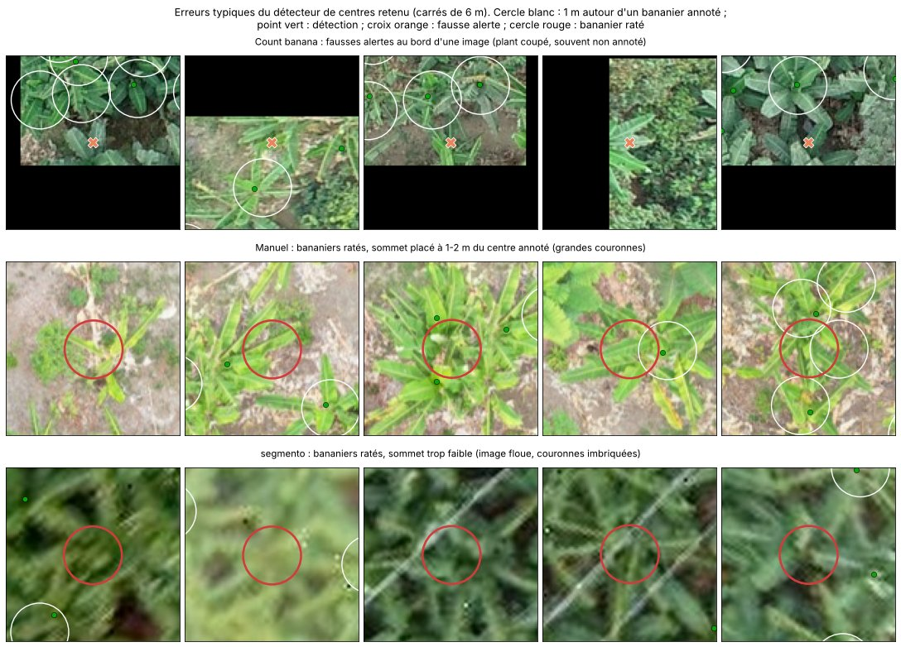
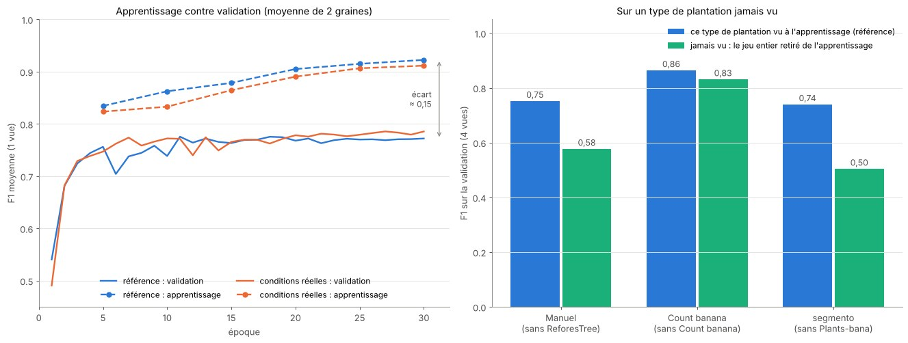
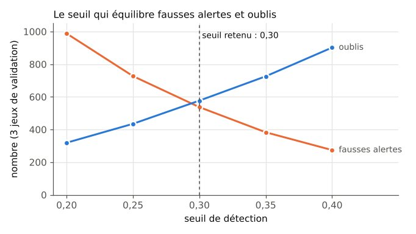
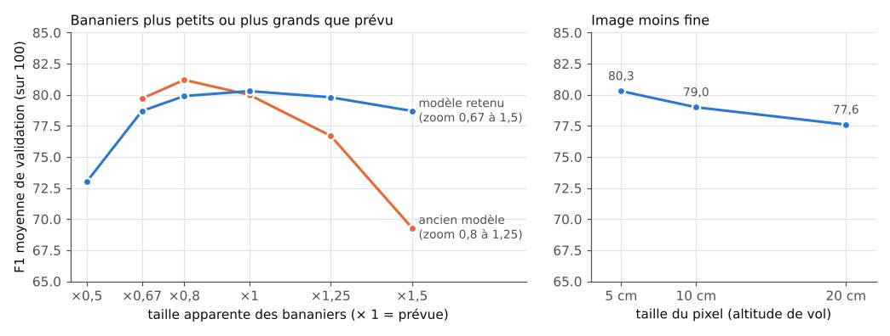
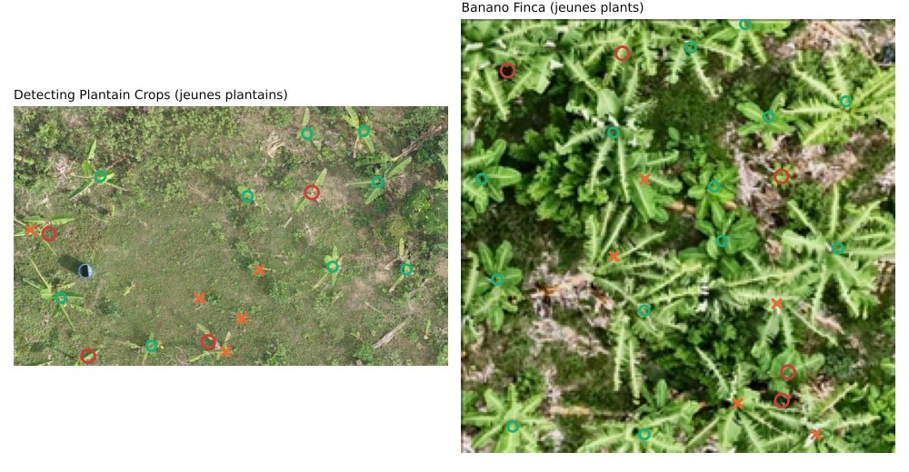

# Journal des essais — Field Scan

Mis à jour le 05/11/2026. Les données utilisées sont décrites dans le [carnet de données](carnet_donnees.md).

## Comment je note

- **Précision** : parmi mes détections, combien sont justes (« quand je dis oui, ai-je raison ? »). Basse = beaucoup de fausses alertes.
- **Rappel** : parmi les vrais cas, combien j'en trouve (« est-ce que je n'en oublie pas ? »). Bas = beaucoup de ratés.
- **F1** : combine les deux ; il n'est bon que si les deux le sont. F1 = 2 × précision × rappel / (précision + rappel).
- **Comptage** : une détection est juste si son centre est à moins de 1 m du centre d'un vrai bananier, chaque bananier ne pouvant être trouvé qu'une fois (règle du sujet).
- **Score honnête ou optimiste** : un score est honnête si les réglages (seuil, époque…) ont été choisis sur d'autres données que celles qui sont notées. Sinon, il est optimiste.

## 1. Comptage des bananiers

### v2 (`entrainement/comptage_v2_kaggle.ipynb`)

**Données** (préparées par `outils/preparer_comptage.py`, détail dans le carnet, sections 4, 8 et 11) : toutes les images sont remises à 5 cm par pixel, et chaque bananier devient un point (le centre de sa boîte) avec le diamètre de sa couronne. Découpage par ferme, par vol ou par zone, jamais au hasard ; aucun doublon entre les parties (`outils/verifier_doublons_comptage.py`).

| Jeu | Apprentissage | Validation | Test (une seule fois, à la fin) |
|---|---|---|---|
| ReforesTree (fermes mélangées) | Flora, Leonor, Guevara, Arteaga : 621 bananiers | Manuel : 133 | Nestor : 235 |
| Count banana plants (bananeraie) | vols 0221 et 0222 : 302 images, 4 060 bananiers | vols 0223 et 0224 : 98 images, 611 | — |
| Plants-bana `segmento` (bananeraie dense) | zone de gauche : 47 images, 12 039 | bas droite, ouest : 17 images, 1 870 | 22 images, 2 498 (26 images, 2 801 avant retrait des 4 morceaux qui touchent la validation, voir « Protocole du test ») |
| Plants-bana `corte` | 49 images, 809 | — | — |

*La référence, sans aucun modèle : un morceau de chaque jeu. Point rouge : bananier annoté par les auteurs du jeu ; cercle blanc : rayon de 1 m autour de lui, dans lequel une prédiction doit tomber pour compter comme juste.*

**Deux modèles, mêmes données, même notation :**
- **détecteur de centres** : ResNet-18 pré-entraîné + un petit décodeur. Il produit une carte : pour chaque carré de 20 cm, la probabilité qu'un centre de bananier s'y trouve. Pour apprendre, la carte idéale a une petite bosse sur chaque bananier, d'autant plus large que sa couronne est grande ; la perte focale empêche le modèle de tout prédire à zéro (presque tous les carrés sont vides). Un bananier = un sommet de la carte (le plus fort dans un carré de 1,4 m) au-dessus du seuil. 3 détecteurs entraînés avec des graines différentes (0, 1, 2), chacun pendant 30 époques de 2 000 morceaux de 448 px tirés au hasard, et chacun garde sa **dernière époque** ; part de chaque jeu : ReforesTree 30 %, `segmento` 30 %, Count banana 25 %, `corte` 15 % ; miroirs, quarts de tour, changement d'échelle (0,8 à 1,25), luminosité, contraste et saturation ;
- **DeepForest** : détecteur de boîtes, pré-entraîné sur des couronnes d'arbres. Tuiles de 400 px (les images plus petites sont complétées par du noir pour garder la même échelle), mêmes parts de jeux (tuiles répétées), 10 époques, miroirs et luminosité, écrêtage des gradients (sans lui, la perte devenait NaN dès la 1re époque et le modèle ne détectait plus rien). Les boîtes en double sont fusionnées au-delà d'un recouvrement testé entre 0,2 et 0,5 (par défaut, DeepForest fusionne dès 0,05, ce qui efface des bananiers voisins dans une bananeraie dense).

*Ce que voit le détecteur de centres pendant l'apprentissage : un morceau tiré au hasard (en haut) et la carte qu'il doit reproduire (en bas).*

**Règle de choix, fixée avant les essais** : la moyenne des F1 sur les 3 validations (Manuel, Count banana, `segmento`).
- Détecteur de centres : je note le modèle 0 seul et la moyenne des 3 modèles, avec **1 vue** (l'image) ou **4 vues** (l'image, ses deux miroirs et un quart de tour ; les 4 cartes sont remises à l'endroit puis moyennées). La règle retient la meilleure de ces 4 variantes et son seuil. Les modèles 1 et 2 seuls montrent l'écart dû au hasard.
- DeepForest : la règle choisit l'époque, le recouvrement de fusion et le seuil.
- Puis elle départage les deux modèles.

#### Résultats (04/11/2026, validation)

**Détecteur de centres** (F1 moyenne des 3 validations, chaque modèle à sa dernière époque) :

| Variante | 1 vue | 4 vues |
|---|---|---|
| modèle 0 | 0,781 | **0,800** |
| modèle 1 | 0,762 | 0,784 |
| modèle 2 | 0,769 | 0,785 |
| moyenne des 3 | 0,786 | 0,795 |

- les 4 vues améliorent chaque modèle, de 0,016 à 0,022 ;
- le hasard seul fait varier un modèle entre 0,762 et 0,781 ;
- la moyenne des 3 fait mieux qu'un modèle pris au hasard, mais pas mieux que le modèle 0 avec 4 vues. L'écart (0,005) est plus petit que celui dû au hasard, et un modèle seul est 3 fois plus rapide : je suis la règle, **modèle 0, 4 vues, seuil 0,30**.

**Comparaison des deux modèles :**

| Validation | Centres : F1 | précision | rappel | compte | DeepForest : F1 | précision | rappel | compte |
|---|---|---|---|---|---|---|---|---|
| Manuel (ferme mélangée) | 0,781 | 0,81 | 0,75 | 123 / 133 (−8 %) | **0,784** | 0,84 | 0,74 | 117 / 133 (−12 %) |
| Count banana (bananeraie) | **0,873** | 0,82 | 0,94 | 697 / 611 (+14 %) | 0,807 | 0,91 | 0,73 | 490 / 611 (−20 %) |
| `segmento` (bananeraie dense) | **0,747** | 0,75 | 0,74 | 1 839 / 1 870 (−2 %) | 0,704 | 0,63 | 0,81 | 2 411 / 1 870 (+29 %) |
| **F1 moyenne** | **0,800** | | | | 0,765 | | | |

DeepForest : meilleure époque 4 (sur 10), fusion 0,3, seuil 0,5. Temps sur une T4 : 12 min par détecteur de centres, 86 min pour DeepForest.

*À gauche : F1 moyenne à chaque époque (1 vue). DeepForest plafonne dès l'époque 4 ; les détecteurs de centres montent jusqu'à l'époque 10 environ puis oscillent. À droite : F1 moyenne selon le seuil pour les deux modèles retenus.*

*Un morceau de chaque validation. Vert : détection juste ; croix orange : fausse alerte ; cercle rouge : bananier annoté raté.*

*Ce que produit le détecteur de centres retenu : l'image, sa carte de probabilité (4 vues), puis les sommets retenus comparés aux bananiers annotés.*

**Ce que j'en retiens :**
- **le détecteur de centres est retenu** (0,800 contre 0,765). Il est nettement meilleur dans les bananeraies (+0,07 sur Count banana, +0,04 sur `segmento`) et à égalité sur la ferme mélangée ;
- il compte aussi mieux : −8 %, +14 % et −2 %, contre −12 %, −20 % et +29 % pour DeepForest, qui met trop de boîtes dans la bananeraie dense et en oublie dans Count banana ;
- la comparaison est plutôt favorable à DeepForest : son époque est choisie sur la validation (score un peu optimiste), alors que le détecteur de centres garde sa dernière époque, et je n'ai pas testé les 4 vues sur DeepForest ;
- **limite** : chaque validation vient d'un lieu dont une autre partie sert à l'apprentissage (une autre ferme de la même région pour Manuel, d'autres vols du même jeu pour Count banana, une autre zone de la même photo pour `segmento`). Sur une plantation entièrement nouvelle (autre pays, autre drone, autre lumière), le score sera probablement plus bas ; c'est surtout vrai pour `segmento`. Le test final (Nestor et la zone de test de `segmento`) a la même limite.

#### Analyse des erreurs (validation, modèle retenu)

Pour savoir quoi améliorer, j'ai classé toutes les erreurs du modèle retenu selon la distance au bananier annoté le plus proche (fausses alertes) ou au sommet le plus proche (bananiers ratés), puis regardé des exemples.

| Fausses alertes | Count banana | Manuel | `segmento` |
|---|---|---|---|
| à 1-2 m d'un bananier annoté | 76 | 16 | 70 |
| aucun bananier annoté à moins de 2 m | 46 | 7 | 383 |
| doublon (bananier déjà trouvé à moins de 1 m) | 4 | 0 | 1 |
| **total** | **126** | **23** | **454** |

| Bananiers ratés | Count banana | Manuel | `segmento` |
|---|---|---|---|
| un sommet existe à moins de 1 m, mais sous le seuil de 0,30 | 22 | 5 | 347 |
| sommet placé à 1-2 m du centre annoté | 14 | 16 | 121 |
| aucun sommet à moins de 2 m | 0 | 10 | 16 |
| sommet proche, mais déjà attribué à un voisin | 4 | 2 | 1 |
| **total** | **40** | **33** | **485** |

- **Bords des images de Count banana** : 30 % de leur surface est à moins de 1 m du bord, mais seulement 14 % des bananiers annotés s'y trouvent (les plants coupés par le bord sont souvent non annotés). Or 48 % des fausses alertes sont près du bord. Une bonne partie du +14 % de Count banana vient donc du découpage des photos en morceaux de 12 m ; sur une orthomosaïque entière, ce cas n'existe qu'au bord des parcelles.
- **Grandes couronnes (Manuel)** : le modèle trouve le plant, mais place son sommet à 1-2 m du centre annoté, ou en met deux sur la même couronne.
- **Image floue et couronnes imbriquées (`segmento`)** : la plupart des ratés ont un sommet trop faible juste au bon endroit.
- **Petits plants et touffes (Count banana)** : les ratés sont plus petits que la moyenne (couronne médiane de 2,2 m contre 2,9 m), et 10 % d'entre eux ont un autre bananier annoté à moins de 1 m, contre 2 % pour l'ensemble.

*Exemples tirés au hasard dans les trois cas principaux.*

**Réglages après le modèle** (modèle 0, sans réapprentissage ; F1 moyenne, seuil rechoisi à chaque fois) :

| Vues | fenêtre de 1 m | 1,4 m (actuel) | 1,8 m |
|---|---|---|---|
| 1 vue | 0,779 | 0,782 | 0,785 |
| **4 vues (actuel)** | 0,799 | **0,800** | 0,800 |
| 8 vues (4 quarts de tour, avec ou sans miroir) | 0,791 | 0,791 | 0,792 |

8 vues n'apportent rien de plus que 4, et la fenêtre des sommets ne change presque rien : **je garde 4 vues et 1,4 m**. La fenêtre est un carré de cases de 20 cm (5, 7 ou 9 cases) : un sommet doit être le plus fort de ce carré centré sur lui. Deux sommets peuvent donc être à 0,6 m, 0,8 m ou 1 m l'un de l'autre selon la fenêtre ; avec 1,4 m, un rejet à plus de 0,8 m de sa mère peut former son propre sommet et être compté. Les gains éventuels sont donc à chercher dans l'apprentissage.

**Surapprentissage ?** Même modèle (modèle 0, 4 vues, seuil 0,30), noté sur ses propres images d'apprentissage :

| Jeu | F1 sur l'apprentissage | F1 sur la validation | Couronne médiane (apprentissage / validation) |
|---|---|---|---|
| ReforesTree | 0,974 | 0,781 (Manuel) | 2,96 m / 3,14 m |
| Count banana | 0,908 | 0,873 | 2,96 m / 2,90 m |
| `segmento` | 0,898 | 0,747 | 2,75 m / **5,00 m** |
| `corte` | 0,943 | — | 2,96 m |

- Count banana : petit écart, le modèle généralise bien d'un vol à l'autre ;
- ReforesTree : grand écart. Les 4 fermes d'apprentissage ne sont que 4 images (621 bananiers), revues très souvent (30 % des morceaux) : le modèle les connaît presque par cœur ;
- `segmento` : une partie de l'écart vient de la zone de validation elle-même, où les couronnes annotées sont presque deux fois plus grandes que dans la zone d'apprentissage (même photo, même échelle) ;
- la F1 de validation ne baisse pas au fil des époques (courbes plus haut) : cet écart ne dégrade pas la validation, mais il montre que le modèle a appris des détails propres aux images d'apprentissage ;
- Manuel ne compte que 133 bananiers : sa F1 est précise à environ ± 0,04 près.

**Robustesse à l'échelle.** Le modèle attend des images à 5 cm par pixel ; pour les jeux Roboflow, cette échelle est estimée, et une vraie plantation peut avoir des plants plus grands ou plus petits. J'ai réduit ou agrandi les images de validation (et les positions des bananiers) avant de les donner au modèle retenu (4 vues, seuil 0,30 inchangé) :

| Facteur | Les bananiers paraissent | F1 moyenne | Manuel | Count banana | `segmento` | Compte (Manuel / Count / `segmento`) |
|---|---|---|---|---|---|---|
| × 0,67 | 1,5 fois plus petits | 0,797 | 0,768 | 0,833 | 0,790 | −32 % / −15 % / +13 % |
| × 0,8 | 1,25 fois plus petits | 0,812 | 0,790 | 0,869 | 0,776 | −21 % / −5 % / +3 % |
| **× 1** | **comme prévu** | **0,800** | 0,781 | 0,873 | 0,747 | −8 % / +14 % / −2 % |
| × 1,25 | 1,25 fois plus grands | 0,767 | 0,731 | 0,884 | 0,686 | −13 % / 0 % / −2 % |
| × 1,5 | 1,5 fois plus grands | 0,693 | 0,651 | 0,851 | 0,575 | −4 % / −5 % / −19 % |

- le modèle supporte bien des bananiers plus petits que prévu, mais perd beaucoup quand ils sont plus grands (−0,11 à × 1,5) ;
- `segmento` gagne même à être réduit : sa zone de validation a des couronnes de 5 m, contre 2,75 m dans sa zone d'apprentissage. C'est cohérent avec l'écart apprentissage / validation plus haut ;
- le compte est plus sensible que la F1 à l'échelle (−32 % sur Manuel à × 0,67) ;
- conséquence pour `run.py` : il faut remettre chaque orthomosaïque à 5 cm à partir de sa vraie taille de pixel, et les plantations à très grandes couronnes seront le cas le plus difficile. La variante « conditions réelles » (zoom de 0,67 à 1,5 pendant l'apprentissage) vise ce point.

#### Vérification complète et variantes d'apprentissage (`entrainement/comptage_v2_variantes_kaggle.ipynb`, 04/11/2026)

Un seul lancement (environ 3 h sur une T4) pour vérifier le détecteur de centres de A à Z :
- **5 variantes, 2 graines chacune** : `reference` (les réglages actuels, réentraînés dans le même lancement pour comparer à égalité) ; **conditions réelles** (flou de rayon 0,5 à 2 px et recompression JPEG de qualité 30 à 90 au hasard, zoom de 0,67 à 1,5 au lieu de 0,8 à 1,25), visée : images floues, petits plants, autre résolution ; **bosse étroite** (bosse cible = diamètre / 10 au lieu de / 6), visée : sommets décalés sur les grandes couronnes ; **les deux** ; **ReforesTree à 15 %** des morceaux au lieu de 30 %, visée : la mémorisation des 4 fermes ;
- **3 modèles entraînés sans un jeu entier** (1 graine) : sans ReforesTree, sans Count banana, sans Plants-bana. La validation du jeu retiré devient un type de plantation jamais vu ;
- **surapprentissage** : toutes les 5 époques, F1 sur une partie des images d'apprentissage (les 4 fermes ReforesTree, 60 images Count banana, 10 `segmento`, 20 `corte`), au même seuil que la validation.

**Règle fixée avant le lancement** : une variante n'est gardée que si la moyenne de ses 2 graines (4 vues) dépasse d'au moins 0,01 celle de `reference`, parce que le hasard seul fait varier un modèle d'environ 0,02.

**Variantes** (F1 sur la validation, 4 vues) :

| Variante | Graine 0 | Graine 1 | Moyenne | Manuel | Count banana | `segmento` | Gardée ? |
|---|---|---|---|---|---|---|---|
| référence | 0,786 | 0,784 | 0,785 | 0,752 | 0,864 | 0,740 | — |
| **conditions réelles** | 0,795 | 0,800 | **0,798** | 0,760 | 0,879 | 0,753 | **oui (+0,013)** |
| bosse étroite | 0,783 | 0,773 | 0,778 | 0,742 | 0,863 | 0,728 | non |
| les deux | 0,789 | 0,789 | 0,789 | 0,756 | 0,866 | 0,746 | non |
| ReforesTree à 15 % | 0,793 | 0,788 | 0,790 | 0,770 | 0,859 | 0,742 | non |

- **conditions réelles** progresse sur les trois validations à la fois, avec ses deux graines : c'est la seule variante gardée ;
- **bosse étroite** n'aide pas : les sommets décalés ne viennent pas de la largeur de la cible ;
- **ReforesTree à 15 %** fait monter Manuel (0,770 contre 0,752) et baisser un peu la mémorisation des fermes, mais pas assez au total pour passer la règle ;
- le modèle 0 retenu au lancement précédent (0,800) avait eu un peu de chance : la même recette donne ici 0,786 et 0,784.

**Surapprentissage** (F1 sur l'apprentissage et sur la validation, 4 vues, moyenne des 2 graines) :

| Variante | Apprentissage | Validation | Écart | ReforesTree apprentissage / Manuel |
|---|---|---|---|---|
| référence | 0,933 | 0,785 | 0,148 | 0,975 / 0,752 |
| conditions réelles | 0,921 | 0,798 | **0,124** | 0,965 / 0,760 |
| les deux | 0,900 | 0,789 | 0,111 | 0,960 / 0,756 |
| ReforesTree à 15 % | 0,930 | 0,790 | 0,139 | **0,950 / 0,770** |

- la F1 sur l'apprentissage monte jusqu'à la dernière époque, alors que la validation plafonne vers l'époque 10 sans jamais redescendre : le modèle continue d'apprendre ses images sans mieux généraliser, mais ce n'est pas un surapprentissage qui dégrade la validation ;
- les augmentations « conditions réelles » réduisent l'écart (0,124 contre 0,148) tout en améliorant la validation ;
- l'écart vient surtout de ReforesTree (4 fermes, presque apprises par cœur) et de `segmento` (zone de validation aux couronnes deux fois plus grandes) ; il est faible sur Count banana (0,02 à 0,04).

**Sur un type de plantation jamais vu** (1 graine, 4 vues) :

| Jeu retiré de l'apprentissage | F1 sur ce jeu, jamais vu | F1 quand il est appris (référence) | Perte |
|---|---|---|---|
| Count banana (bananeraie, plants séparés) | 0,831 | 0,864 | −0,03 |
| ReforesTree (fermes mélangées) | 0,577 (Manuel) | 0,752 | −0,18 |
| Plants-bana (bananeraie dense et floue) | 0,504 (`segmento`) | 0,740 | −0,24 |

*À gauche : F1 sur l'apprentissage (tirets) et sur la validation (traits pleins) au fil des époques. À droite : F1 sur un type de plantation vu ou jamais vu à l'apprentissage.*

- une bananeraie aux plants bien séparés se reconnaît même sans exemple de ce jeu (−0,03) ;
- une ferme mélangée ou une bananeraie dense et floue jamais vues font chuter le score de 0,18 à 0,24 : **chaque type de plantation doit être représenté à l'apprentissage**. Sur une plantation d'un type nouveau, il faut s'attendre à un score nettement plus bas que celui de la validation, et le dire dans le bulletin ;
- sans Plants-bana, le modèle n'a plus que 4 fermes et des plants séparés : sa perte d'apprentissage descend très bas (0,19 contre 0,45) et il apprend ses images par cœur (0,98 sur les fermes d'apprentissage).

**Modèle retenu** : variante **conditions réelles**. Comme au lancement précédent, la règle départage le modèle 0 seul (0,795) et la moyenne des graines (**0,803**, seuil 0,25) : **moyenne des 2 modèles, 4 vues** (le seuil passe ensuite à 0,30, voir plus bas). Manuel 0,769, Count banana 0,879, `segmento` 0,761 ; compte +2 %, +14 %, +11 %. Les poids sont `centres_conditions_reelles_0.pt` et `centres_conditions_reelles_1.pt`. Je les ai rechargés hors de Kaggle et j'obtiens exactement les mêmes scores (0,803 au seuil 0,25).

**Les autres arbres sont-ils pris pour des bananiers ?** Dans la parcelle de Manuel, 57 arbres annotés ne sont pas des bananiers (cacaoyers et autres arbres de la ferme). Avec le modèle retenu, **aucun** n'a de détection à moins de 1 m, et aucune des 30 fausses alertes de Manuel ne tombe sur l'un d'eux. Le modèle ne confond donc pas les autres arbres de ces fermes avec des bananiers. Je n'ai pas d'image de palmiers ou de cocotiers : ce cas-là n'est pas vérifié.

**Plusieurs échelles à la prédiction ?** Avec le modèle retenu, prédire aussi sur l'image réduite (× 0,8, × 0,67) et faire la moyenne des cartes n'apporte rien (0,797 à 0,805 contre 0,803) : le zoom de 0,67 à 1,5 pendant l'apprentissage rend déjà le modèle robuste à la taille des plants. Je garde une seule échelle.

#### Modèle final et contrôles (05/11/2026)

**Fichiers plus légers.** Les poids sont enregistrés en 16 bits au lieu de 32 : 23 Mo par fichier au lieu de 45. Règle fixée avant : je les garde si les scores restent identiques à 0,002 près. Sur la validation, une seule détection change sur 2 906 (0,8029 contre 0,8030). Le code de run.py (`comptage/detecteur.py`) redonne exactement les scores du notebook, y compris sur Manuel, qu'il découpe en morceaux de 2 048 px.

**Réentraînement final** (`entrainement/comptage_v2_final_kaggle.ipynb`). Une fois tous les choix figés sur la validation, je réentraîne les 2 modèles avec la même recette sur apprentissage + validation : une 5e ferme ReforesTree, les 4 vols de Count banana, deux zones de `segmento`. Le manque de types de plantation étant la principale limite, je préfère montrer au modèle livré le plus de données possible. Décidé avant de voir le test : c'est lui le modèle final.

**Garde-fou.** Noté sur ses 518 images apprises, le modèle réentraîné fait 0,901, contre 0,903 pour le modèle de validation. Pris à la lettre (« au moins aussi bien »), le garde-fou échoue de 0,002. L'entraînement n'a pourtant pas raté : sur la validation, qu'il a apprise, il passe de 0,803 à 0,864, et l'écart est dix fois plus petit que la variation due au hasard d'un entraînement. Le garde-fou oubliait un détail : en apprenant plus d'images avec le même nombre de pas, le modèle revoit moins souvent chacune. Pour trancher sans deviner, j'ai noté les deux modèles sur deux plantations qu'aucun des deux n'a vues (plus bas), avec une règle fixée avant : garder le modèle réentraîné, sauf si l'autre fait mieux d'au moins 0,01. Résultat : 0,725 contre 0,727. **Je garde le modèle réentraîné**, en 16 bits (0,8643 contre 0,8642 en 32 bits).

#### Le seuil : équilibrer fausses alertes et oublis

L'organisation note la F1, mais aussi l'erreur de comptage par parcelle. Le mentor le dit simplement : sur 1 000 bananiers, en compter 50 de trop et en rater 60 donne un bon total. Le seuil de 0,25 maximisait la F1 seule, et le modèle comptait trop (+2 %, +14 %, +11 %). Nouvelle règle, fixée le 05/11 avant le test et appliquée sur la validation : parmi les seuils dont la F1 moyenne est à moins de 0,005 de la meilleure, je prends celui où fausses alertes et oublis sont le plus proches.

*Fausses alertes et oublis sur les 3 jeux de validation, selon le seuil (modèle de validation, 4 vues).*

| Seuil | F1 moyenne | Compte (Manuel / Count banana / `segmento`) |
|---|---|---|
| 0,25 | **0,803** | +2 % / +14 % / +11 % |
| **0,30** | 0,800 | −2 % / +9 % / −5 % |
| 0,35 | 0,789 | −10 % / 0 % / −18 % |

**Seuil retenu : 0,30.** La F1 ne perd que 0,003, et l'erreur de compte moyenne passe de 8,8 % à 5,0 %. Pour les maladies, je garde l'inverse : une feuille malade ratée est plus grave qu'une fausse alerte.

#### Ce que le modèle supporte : taille des plants et résolution

*À gauche : images de validation agrandies ou réduites avant de les donner au modèle. À droite : images réduites à 10 ou 20 cm par pixel, puis remises à 5 cm, comme un vol plus haut.*

- **La taille des plants n'est plus un gros risque.** Le zoom de 0,67 à 1,5 pendant l'apprentissage a rendu le modèle robuste : avec des bananiers 1,5 fois plus grands que prévu, il perd 1,6 point, contre 10,7 pour l'ancien modèle. Il ne décroche vraiment que si les plants paraissent deux fois plus petits (× 0,5).
- **Une image moins fine coûte peu** : moins de 3 points à 20 cm par pixel, soit un vol 4 fois plus haut.

#### Plantations jamais vues

Pour savoir ce que vaut le modèle sur un type de plantation qu'il n'a jamais appris, j'utilise deux petits jeux décrits dans le carnet (section 12) : Detecting Plantain Crops (jeunes plantains dans la brousse) et Banano Finca (jeunes plants vus de très bas). Ils servent seulement à décider : jamais à l'apprentissage, et leurs scores ne sont pas des scores de test.

| Jeu jamais vu (seuil 0,25) | Modèle réentraîné | Modèle de validation |
|---|---|---|
| Detecting Plantain Crops (19 images, 208 plantains) | 0,670 (compte +17 %) | 0,673 (+13 %) |
| Banano Finca (25 images, 409 plants) | 0,779 (compte −24 %) | 0,781 (−27 %) |
| **Moyenne** | **0,725** | **0,727** |

*Modèle réentraîné sur une image de chaque jeu. Cercle vert : détection juste ; croix orange : fausse alerte ; cercle rouge : plant annoté raté.*

Sur un type de plantation jamais vu, la F1 tombe vers 0,72, contre 0,80 sur la validation. Sur les jeunes plants, le modèle en oublie environ un sur trois. Ces deux jeux sont petits et viennent chacun d'une seule scène : leur F1 est imprécise à quelques points près.

#### Deux idées écartées : choix automatique du zoom et AdaBN

Deux idées venues d'une relecture critique, qui ne changent que la façon de prédire, sans réentraîner :
- **choix automatique du zoom** : sur une zone, le modèle prédit avec plusieurs zooms (× 0,5 à × 2) et garde celui où ses détections sont les plus sûres d'elles. Une moyenne de plusieurs zooms n'apportait rien ; ici, on en choisit un ;
- **AdaBN** : les moyennes que le ResNet-18 a retenues des images d'apprentissage sont recalculées sur les images de la nouvelle zone, sans étiquette.

Règle fixée avant : une idée est gardée si elle gagne au moins 0,01 sur les deux plantations jamais vues, sans faire perdre plus de 0,02 sur un jeu de validation.

| | Plantain | Banano Finca | Moyenne | Validation |
|---|---|---|---|---|
| sans idée | 0,670 | 0,779 | 0,725 | — |
| zoom automatique | 0,698 | 0,765 | 0,732 | `segmento` −0,027 |
| AdaBN | 0,593 | 0,589 | 0,591 | −0,07 à −0,10 sur chaque jeu |

**Les deux sont écartées.** La confiance du modèle ne désigne pas le bon zoom, et recalculer la normalisation sur quelques images d'une seule scène abîme nettement le modèle.

#### Dernier essai : nouveaux jeux de jeunes plantations (en cours)

Puisque le modèle rate surtout les plantations qu'il n'a jamais vues, le seul vrai remède est de lui en montrer. J'ajoute trois jeux Roboflow, à l'apprentissage seulement (carnet, section 13) : des jeunes plants en rangs, du plantain et une autre jeune plantation. Règles fixées avant l'essai :
- même recette, 2 graines ; les nouveaux jeux font 30 % des morceaux, les anciens gardent leurs proportions entre eux ;
- comparaison avec le modèle de validation, chacun à son seuil d'équilibre ;
- gardé si la F1 moyenne sur les deux plantations jamais vues gagne au moins 0,01, sans perte de plus de 0,02 sur un jeu de validation ;
- si c'est gardé : réentraînement final avec tout. Le garde-fou est corrigé : sur les images apprises, le modèle final doit faire au moins aussi bien que le modèle d'essai, à 0,02 près.

#### Protocole du test, fixé avant de le lancer (05/11/2026)

- **modèle** : le modèle final (moyenne des 2 modèles, 4 vues, 16 bits), au seuil donné par la règle d'équilibre (0,30 aujourd'hui) ;
- **`segmento`** : la zone de validation et la zone de test du bas se touchent. Les 4 morceaux de test qui bordent la validation (303 bananiers) sont retirés : un bananier coupé par ce bord aurait été vu à moitié pendant l'apprentissage. Il reste 22 morceaux et 2 498 bananiers ;
- **jeunes bananiers** (3 photos drone, carnet section 11) : seuls les plants à moins de 2 000 px du centre de chaque photo comptent ; photos remises à 5 cm à partir de leur échelle estimée (environ 1,1 cm par pixel). Je note les mères seules et tous les plants, photo par photo. Je compare 0544, annotée entièrement à la main, à 0546 et 0548, pré-annotées puis corrigées ;
- **rejets** : je compte les rejets annotés qui reçoivent leur propre détection, c'est-à-dire comptés comme un pied de plus ;
- **mesures** : F1 à 1 m, précision, rappel, erreur de comptage totale et par image (plus proche de l'erreur par parcelle que mesure l'organisation) ;
- **marges d'erreur** : les bananiers d'une même image ne sont pas indépendants. Les intervalles à 95 % se calculent donc en tirant au hasard des morceaux entiers (`segmento`) ou des blocs de 20 m (Nestor). Trois photos DJI ne suffisent pas pour un intervalle ;
- le test n'est lancé qu'une fois, et aucun réglage ne change après.

### Premier essai

- DeepForest entraîné sur Count banana plants seul : F1 0,876 sur ses vols de validation (précision 0,86, rappel 0,90). Score optimiste : le seuil a été choisi sur ces mêmes vols.

## 2. Maladies

### v1 (MobileNetV3)

Apprentissage sur Tanzanie 2023, validation sur Tanzanie 2025 (3 001 images), test sur le Bangladesh (autre pays).

- **Validation** : F1 0,926, meilleure époque : la 3e sur 8. Seuil « je ne sais pas » : 0,679 (confiance en dessous de laquelle le modèle refuse de répondre).
- **Test Bangladesh** : 69 % de bonnes réponses sur les classes connues, rappel de la Sigatoka 66 %, 3 % de fausses alertes sur les feuilles saines. Maladies inconnues (Cordana, Pestalotiopsis) : seulement 20 % rejetées, le modèle les prend le plus souvent pour une maladie connue, avec confiance.

### v2 (`entrainement/maladies_v2_kaggle.ipynb`)

Données nettoyées à nouveau (voir le carnet) : apprentissage sur Tanzanie 2023 + Pérou (16 959 images), validation sur toute la Tanzanie 2025 (11 766), test sur le Bangladesh (893). Tous les choix sont faits sur la validation, avec des règles fixées avant chaque essai ; le Bangladesh n'a servi à aucun choix.

**Modèle final retenu :** ConvNeXt-Tiny pré-entraîné sur ImageNet, Pérou tiré 3 fois plus souvent, recompression JPEG et lissage des étiquettes, **moyenne de 3 modèles** entraînés avec des graines différentes, 4 vues.

**Résultat au test (Bangladesh, autre pays, utilisé une seule fois) :** 95 % des Sigatoka nommées, aucune dite saine ; 1 feuille saine sur 90 signalée malade ; aucune des 331 maladies inconnues dite saine (21 % en « je ne sais pas », les autres signalées malades). Détail en fin de section.

#### Comment le modèle apprend

Pendant l'entraînement, chaque photo est modifiée au hasard à chaque passage : cadrage et zoom, miroirs, rotation (jusqu'à 30°), couleurs et lumière, flou, une zone masquée, et une recompression JPEG plus ou moins forte (pour imiter d'autres téléphones). Le modèle ne voit jamais deux fois exactement la même image, et ne peut pas se fier à un seul détail.

*Une photo d'entraînement et 9 versions tirées au hasard. Les coins noirs viennent de la rotation, le rectangle gris est la zone masquée.*

Autres réglages : 6 époques, modèle de la dernière époque gardé ; lissage des étiquettes 0,1 (la bonne réponse vaut 0,9 au lieu de 1, pour que le modèle soit moins sûr de lui à tort). Chacun des 3 modèles part des mêmes poids ImageNet ; seule la graine du hasard change (départ de la dernière couche, ordre des photos, modifications tirées). Leurs probabilités sont moyennées.

#### Comment le modèle décide

Chaque photo est regardée sous 4 vues ; les probabilités des 3 modèles et des 4 vues sont moyennées.

La décision se fait ensuite en deux étapes :

1. **malade ou saine ?** La feuille est malade si P(Black Sigatoka) + P(Fusarium) dépasse le seuil d'alerte. Une feuille malade ratée est l'erreur la plus grave : le seuil est celui qui rend le plus petit possible *2 × malades ratées + fausses alertes* (une malade ratée compte comme deux fausses alertes) ;
2. **quelle maladie ?** La maladie n'est nommée que si le modèle est assez sûr entre les deux (seuil choisi pour que le nom soit juste 95 % du temps). Sinon : « malade, non identifiée ».

Si la confiance du modèle est trop basse (seuil qui garde 95 % des photos de validation), la réponse est « je ne sais pas ».

| | Modèle sûr de lui | Modèle hésitant |
|---|---|---|
| Malade (étape 1), maladie claire | Black Sigatoka ou Fusarium | je ne sais pas |
| Malade, hésite entre les deux maladies | malade, non identifiée | je ne sais pas |
| Saine (étape 1) | saine | je ne sais pas |

#### Choix testés sur la validation

| Question | Résultat | Choix |
|---|---|---|
| Comment choisir le seuil d'alerte ? | 0,5 fixe : 167 malades ratées et 105 fausses alertes, contre 96 et 189 au seuil de coût minimal (0,30, même entraînement). F2 : choisit 0,05, le plus bas testé (427 fausses alertes), car avec 2,5 fois plus de malades que de saines elle réagit à peine aux fausses alertes | coût (malade ratée = 2 fausses alertes) |
| Quelle époque garder ? | garder l'époque au coût le plus bas a donné une fois l'époque 1 : un modèle qui repère bien les malades mais ne nomme que 49 % des Fusarium. Le coût saute aussi beaucoup d'une époque à l'autre | la dernière époque |
| 1 vue ou 4 vues ? | 4 vues ont fait mieux dans tous les essais (par exemple coût 392 contre 337 pour EfficientNet-B2) | 4 vues |
| Comment repérer une maladie inconnue ? | voir « Inconnues simulées » | confiance |
| Quel réseau ? | ConvNeXt-Tiny gagne sur tous les critères, avec ou sans le Pérou | ConvNeXt-Tiny |
| Le Pérou aide-t-il ? | le coût baisse avec le Pérou pour les 4 réseaux | Pérou, poids 3 |
| Recompression JPEG et lissage ? | coût égal (213 et 213) ; à coût égal, je garde celui qui rate le moins de malades (36 contre 48) | oui |
| Un modèle ou la moyenne de 3 ? | coût 191 pour le 1er modèle seul, 167 pour la moyenne des 3 | moyenne de 3 |

#### Tous les essais

6 époques, modèle de la dernière époque, mêmes réglages sauf ce qui est indiqué. « Pérou 3 » : chaque photo du Pérou est tirée 3 fois plus souvent (20 % de chaque tour) ; « Pérou 0 » : sans le Pérou. Les deux dernières colonnes reprennent les archives `HEALTHY-1`, `BLACK SIGATOKA-1` et `FUSARIUM WILT-1` de la validation (1 000, 1 000 et 1 001 photos), avec la règle simple « malade si P(malade) ≥ 0,5 », sans « je ne sais pas ».

| Réseau (taille) | Réglage | Coût | Malades dites saines (sur 8 428) | dont Fusarium (sur 4 932) | Fausses alertes (saines) | Nom juste | Archives -1 bien classées : saine / Sigatoka / Fusarium | Fusarium dites saines (archives -1) |
|---|---|---|---|---|---|---|---|---|
| MobileNetV3 (4,2 M) | Pérou 3 | 427 | 88 | 81 | 4,4 % | 93,5 % | 987 / 967 / 875 | 39 |
| MobileNetV3 | Pérou 1 | 564 | 131 | 114 | 6,1 % | 92,8 % | 969 / 951 / 865 | 49 |
| MobileNetV3 | Pérou 0 | 642 | 132 | 91 | 7,1 % | 92,2 % | 948 / 927 / 912 | 29 |
| EfficientNet-B0 (4,0 M) | Pérou 0 | 419 | 78 | 56 | 4,2 % | 93,5 % | 964 / 964 / 912 | 11 |
| EfficientNet-B0 | Pérou 3 | 367 | 108 | 82 | 2,7 % | 94,1 % | 987 / 985 / 870 | 36 |
| EfficientNet-B2 (7,7 M) | Pérou 0 | 493 | 70 | 43 | 6,6 % | 92,4 % | 952 / 932 / 949 | 6 |
| EfficientNet-B2 | Pérou 3 | 337 | 77 | 43 | 1,9 % | 94,4 % | 987 / 981 / 888 | 13 |
| ConvNeXt-Tiny (27,8 M) | Pérou 0 | 242 | 23 | 21 | 2,8 % | 95,0 % | 941 / 970 / 938 | 6 |
| ConvNeXt-Tiny | Pérou 3 | 213 | 48 | 40 | 1,0 % | 96,0 % | 992 / 983 / 911 | 9 |
| ConvNeXt-Tiny | Pérou 3, JPEG, lissage | 213 | 36 | 29 | 1,5 % | 95,5 % | 963 / 977 / 913 | 4 |
| ConvNeXt-Tiny | Pérou 3, JPEG, lissage, moyenne de 3 | 167 | 30 | 26 | 1,8 % | 96,5 % | 993 / 981 / 922 | 10 |
| **ConvNeXt-Tiny** | **mêmes réglages, entraînement final (celui testé)** | **154** | **30** | **25** | **1,0 %** | **96,9 %** | **988 / 985 / 923** | **7** |

- **Le réseau** : ConvNeXt-Tiny fait nettement mieux que les autres (coût 213 contre 337 pour B2, avec ou sans le Pérou). Il est 6 à 7 fois plus gros que B0, mais reste utilisable sans GPU ;
- **le Pérou** : avec MobileNetV3, plus il y a de Pérou, meilleur est le résultat sur tous les critères (642, 564, 427). Avec les autres réseaux, il réduit surtout les fausses alertes, parfois au prix d'un peu plus de Fusarium ratées (le Pérou n'a pas de Fusarium). Le coût baisse avec le Pérou pour les 4 réseaux ;
- **la moyenne de 3 modèles** baisse le coût de 191 à 167 (puis de 196 à 154 lors de l'entraînement final) : les erreurs dues au hasard d'un entraînement se compensent ;
- **le hasard d'un entraînement** : deux entraînements identiques de MobileNetV3 ont donné 427 et 419 ; les 3 ConvNeXt de la moyenne, seuls et sur une vue, 225, 243 et 201. Je ne tire donc de conclusion que des écarts nets ou réguliers.

Le modèle testé est celui de l'entraînement final (mêmes réglages, réentraîné avant le test). Ses seuils, réglés sur la validation : alerte 0,30, nom de la maladie 0,50, confiance 0,646. Le seuil pour nommer la maladie tombe à 0,50 : le nom est assez fiable pour être toujours donné, la réponse « malade, non identifiée » n'est donc jamais utilisée.

**Détail par classe sur la validation** (entraînement précédent avec les mêmes réglages ; l'entraînement final donne des chiffres très proches : 30 malades dites saines, 1,0 % de fausses alertes, nom juste 96,9 %) :

| Classe réelle | Saine | Black Sigatoka | Fusarium | Malade, non identifiée | Je ne sais pas |
|---|---|---|---|---|---|
| Saine (3 338) | **3 231 (96,8 %)** | 10 | 51 | 0 | 46 |
| Black Sigatoka (3 496) | 4 | **3 267 (93,5 %)** | 41 | 0 | 184 |
| Fusarium (4 932) | 26 | 174 | **4 373 (88,7 %)** | 0 | 359 |

- 30 feuilles malades sur 8 428 (0,4 %) sont dites saines ; toutes les autres reçoivent une alerte ou un « je ne sais pas » ;
- 1,8 % des feuilles saines reçoivent une fausse alerte ;
- quand la maladie est nommée, elle est juste 96,5 % du temps ;
- le Fusarium reste le plus difficile : 3,5 % sont prises pour de la Black Sigatoka.

#### Inconnues simulées

Pour choisir comment repérer une maladie jamais vue sans toucher au Bangladesh, j'entraîne un modèle sans l'une des deux maladies, puis je la lui montre. Chaque méthode est réglée pour garder 95 % des photos connues de la validation.

| Maladie retirée | Rejetée par la confiance | Rejetée par la distance aux photos d'apprentissage | Les deux |
|---|---|---|---|
| Fusarium | **50 %** | 1 % | 32 % |
| Black Sigatoka | 8 % | 14 % | 14 % |

La distance (Mahalanobis, sur le résumé de 1 280 nombres que le réseau calcule pour chaque photo) fait moins bien que le hasard pour séparer connu et inconnu (AUROC 0,40 et 0,43, 0,5 = hasard). Mon explication probable : elle repère surtout que les photos de 2025 diffèrent de celles de 2023, pas qu'une maladie est nouvelle. Je garde donc la confiance seule (simulation faite avec MobileNetV3). Une maladie à taches comme la Sigatoka est très difficile à reconnaître comme inconnue (8 %) : la Cordana et la Pestalotiopsis du Bangladesh étant aussi des maladies à taches, je m'attends à peu de « je ne sais pas » sur elles au test. Ce qui comptera surtout, c'est qu'elles ne soient pas dites saines.

#### Cartes d'attention

Pour vérifier où le modèle regarde, j'utilise Grad-CAM : en rouge, les zones qui ont le plus pesé dans sa réponse (premier des 3 modèles finaux).

*Photos de validation tirées au hasard : 4 saines, 4 Black Sigatoka, 4 Fusarium, et 4 Fusarium prises pour de la Black Sigatoka.*

- saines : l'attention est répartie sur le limbe et les bords, et non plus concentrée sur la nervure centrale comme avec le premier MobileNetV3 (zone masquée et recadrages) ;
- Black Sigatoka : le modèle regarde les lésions (4e photo), mais aussi parfois des bords d'image ;
- Fusarium : zones jaunies ou desséchées ;
- Fusarium pris pour de la Black Sigatoka : le modèle s'arrête sur une marque locale (tache sèche, bord déchiré) qu'il prend pour une lésion ;
- aucun raccourci de décor net (fond, mains, tuyaux), mais les cartes de ConvNeXt sont plus diffuses que celles de MobileNetV3 : elles montrent une région, pas une tache précise. 16 photos ne suffisent pas pour conclure.

#### Test Bangladesh (03/11/2026, une seule fois)

Modèle final, avec les seuils réglés sur la validation, sans aucun changement après le test. La Sigatoka du Bangladesh (type non précisé) compte comme Black Sigatoka.

| Classe réelle (Bangladesh) | Saine | Black Sigatoka | Fusarium | Je ne sais pas |
|---|---|---|---|---|
| Saine (90) | **86 (95,6 %)** | 0 | 1 | 3 |
| Sigatoka (472) | 0 | **449 (95,1 %)** | 10 | 13 |
| Cordana, inconnue (159) | 0 | 93 | 13 | **53 (33 %)** |
| Pestalotiopsis, inconnue (172) | 0 | 138 | 17 | **17 (10 %)** |

| | v1 | v2 |
|---|---|---|
| Bonnes réponses sur les classes connues (saine et Sigatoka) | 69 % | **95,2 %** |
| Sigatoka nommée | 66 % | **95,1 %** |
| Sigatoka dite saine | — | **0 %** |
| Feuilles saines signalées malades | 3 % | **1,1 %** (1 sur 90) |
| Maladies inconnues en « je ne sais pas » | 20 % | 21 % |
| Maladies inconnues dites saines | — | **0 %** |

- **Le changement de pays tient** : la v1 retrouvait 66 % des Sigatoka au Bangladesh, la v2 en nomme 95 % et n'en déclare aucune saine, pour des scores de validation proches ;
- **aucune feuille malade n'est dite saine**, ni Sigatoka, ni maladie inconnue : toutes reçoivent une alerte ou un « je ne sais pas » ;
- **le « je ne sais pas » reste faible** (21 %, comme en v1), comme la simulation l'annonçait pour des maladies à taches : 70 % des maladies inconnues sont prises pour de la Black Sigatoka. La confiance sépare mal connu et inconnu (AUROC 0,73 ; 0,5 = hasard). Pour un agriculteur, la feuille est quand même signalée malade, mais avec un nom qui peut être faux ;
- le test ne contient pas de Fusarium : la reconnaissance du Fusarium dans un autre pays n'est pas mesurée.

#### Fichiers plus légers (16 bits, 05/11/2026)

Les poids des 3 modèles sont enregistrés en 16 bits au lieu de 32 : chaque fichier passe de 111 à 56 Mo (168 Mo pour les 3). Au moment de prédire, ils sont remis en 32 bits : seul l'arrondi des poids peut changer une réponse. Règle fixée avant l'essai : je garde les 16 bits si les réponses restent identiques ou presque. Sur 1 200 photos de validation tirées au hasard (400 par classe), **aucune réponse ne change** ; le plus grand écart de probabilité est de 0,0006. Ce sont ces fichiers que run.py utilise.

## 3. Vigueur et stress hydrique (Sentinel-2 et drone, `run.py`)

Ici, pas d'apprentissage : des indices calculés à partir des bandes, et des règles simples. Je n'ai pas de vérité terrain pour noter ces cartes. Je vérifie qu'elles sont cohérentes avec ce qu'on voit sur les images et avec les saisons.

**Les indices, et pourquoi ceux-là :**
- **NDVI** (proche infrarouge B08, rouge B04) : la chlorophylle absorbe le rouge, et les feuilles saines renvoient beaucoup de proche infrarouge. Il mesure la quantité de feuillage vert ;
- **NDRE** (B8A, bord du rouge B05) : plus sensible à la chlorophylle quand le feuillage est déjà dense et que le NDVI sature. Calculé et exporté, il ne sert pas aux alertes ;
- **NDMI** (B8A, infrarouge moyen B11) : l'eau des feuilles absorbe l'infrarouge moyen. Il baisse quand le feuillage s'assèche ;
- **drone RGB** (sans infrarouge) : ExG et VARI, comme le demande le sujet. Pour juger les zones, je sépare végétation et sol avec l'ExG (seuil d'Otsu), puis je calcule la part de végétation par case de 10 m.

**Les règles :**
- **vigueur faible** : un indice sous 80 % du niveau normal de la plantation (75e centile). La règle est relative, parce que le niveau normal change d'un site, d'une saison et d'un capteur à l'autre ;
- **manque d'eau probable** : un NDMI plus bas de 0,05 que ce qu'on attend pour sa quantité de feuillage. J'ajuste une droite NDMI = a + b × NDVI sur la plantation : une parcelle clairsemée a naturellement un NDMI bas, et ne doit pas passer pour sèche ;
- **saisons** : avec deux dates, une parcelle est signalée si son NDMI baisse de plus de 0,05 de plus que les autres parcelles comparables entre la saison humide et la saison sèche.

**Ce que donnent ces règles :**
- **Cameroun** (15 parcelles, 16/12/2025 et 20/04/2026) : en décembre, 5 parcelles sont clairsemées (NDVI 0,34 à 0,51). En avril, elles remontent à 0,82–0,85 : c'était une replantation, pas un stress. À la date la plus récente, le bulletin signale 4 parcelles : vigueur faible sur les parcelles 2 (83 % de la parcelle) et 11 (44 %), manque d'eau probable sur la 14 (74 %), et une baisse d'eau plus forte que les autres entre les deux dates sur les parcelles 10 et 14 ;
- **Équateur** (15 parcelles, 31/03/2026 et 22/09/2026) : plantation homogène, NDVI de 0,79 à 0,86. Aucune zone faible ni sèche ; seule la parcelle 9 perd plus d'eau que les autres entre les deux saisons ;
- **drone, ferme de Manuel** : 65 % de la parcelle passe en vigueur faible. C'est une ferme mélangée, avec des trous et d'autres arbres, et la règle n'est pas calibrée pour ce cas. Je le signale comme limite.

**Reste à faire** : l'ablation des bandes (ce que change chaque indice sur les zones signalées), demandée par le sujet.
