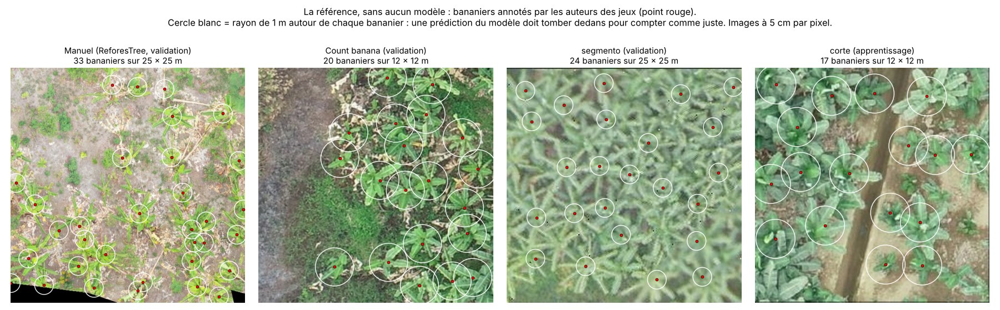
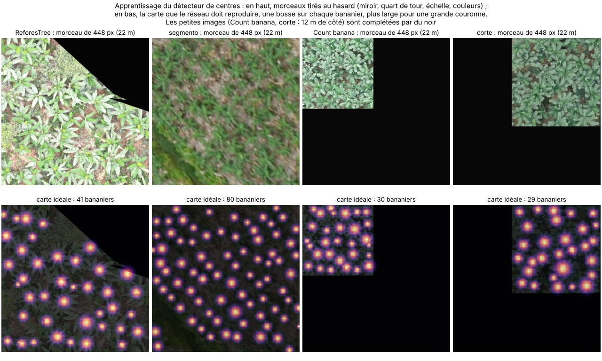
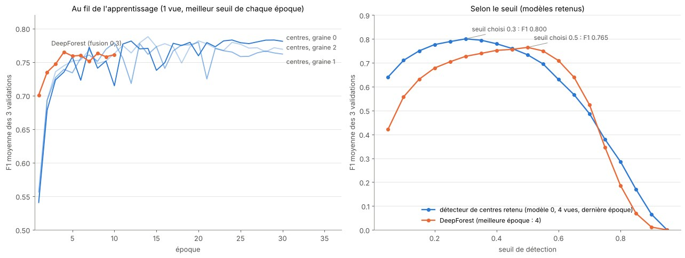
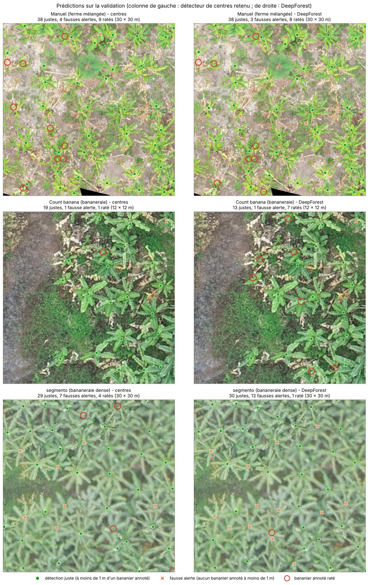
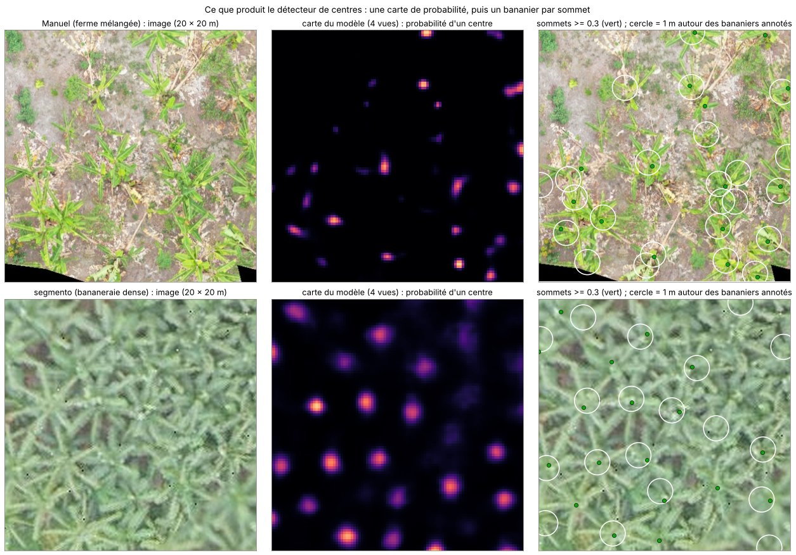
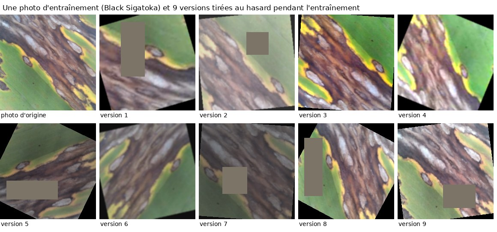
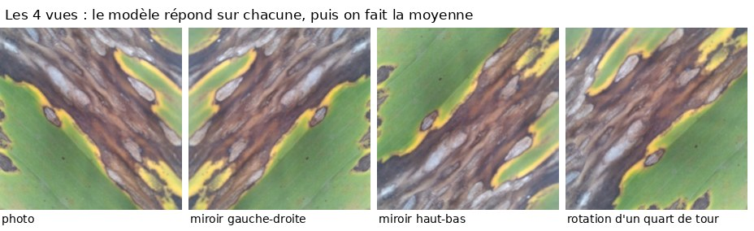
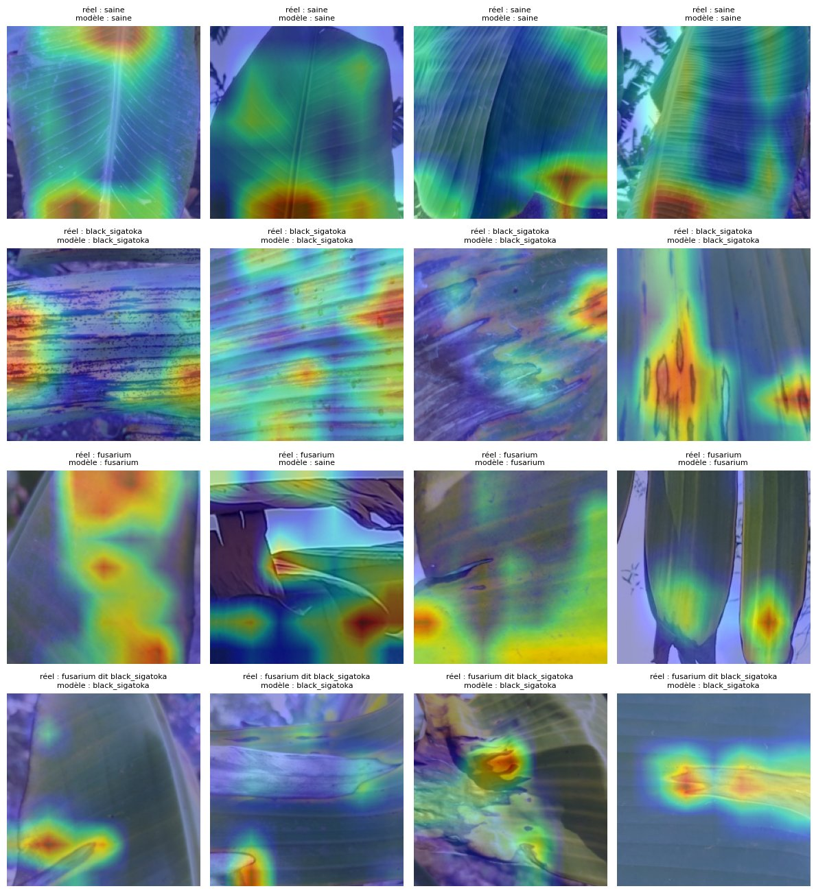

# Journal des essais — Field Scan

Mis à jour le 04/11/2026. Les données utilisées sont décrites dans le [carnet de données](carnet_donnees.md).

## Comment je note

- **Précision** : parmi mes détections, combien sont justes (« quand je dis oui, ai-je raison ? »). Basse = beaucoup de fausses alertes.
- **Rappel** : parmi les vrais cas, combien j'en trouve (« est-ce que je n'en oublie pas ? »). Bas = beaucoup de ratés.
- **F1** : combine les deux ; il n'est bon que si les deux le sont. F1 = 2 × précision × rappel / (précision + rappel).
- **Comptage** : une détection est juste si son centre est à moins de 1 m du centre d'un vrai bananier, chaque bananier ne pouvant être trouvé qu'une fois (règle du sujet).
- **Score honnête ou optimiste** : un score est honnête si les réglages (seuil, époque…) ont été choisis sur d'autres données que celles qui sont notées. Sinon, il est optimiste.

## 1. Comptage des bananiers

### v2 (`entrainement/comptage_v2_kaggle.ipynb`)

**Données** (préparées par `outils/preparer_comptage.py`, détail dans le carnet, sections 4, 8 et 11) : toutes les images sont remises à 5 cm par pixel, et chaque bananier devient un point (le centre de sa boîte) avec le diamètre de sa couronne. Découpage par ferme, par vol ou par zone, jamais au hasard ; aucun doublon entre les parties (`outils/verifier_doublons_comptage.py`).

| Jeu | Apprentissage | Validation | Test (une seule fois, à la fin) |
|---|---|---|---|
| ReforesTree (fermes mélangées) | Flora, Leonor, Guevara, Arteaga : 621 bananiers | Manuel : 133 | Nestor : 235 |
| Count banana plants (bananeraie) | vols 0221 et 0222 : 302 images, 4 060 bananiers | vols 0223 et 0224 : 98 images, 611 | — |
| Plants-bana `segmento` (bananeraie dense) | zone de gauche : 47 images, 12 039 | bas droite, ouest : 17 images, 1 870 | 26 images, 2 801 |
| Plants-bana `corte` | 49 images, 809 | — | — |

*La référence, sans aucun modèle : un morceau de chaque jeu. Point rouge : bananier annoté par les auteurs du jeu ; cercle blanc : rayon de 1 m autour de lui, dans lequel une prédiction doit tomber pour compter comme juste.*

**Deux modèles, mêmes données, même notation :**
- **détecteur de centres** : ResNet-18 pré-entraîné + un petit décodeur. Il produit une carte : pour chaque carré de 20 cm, la probabilité qu'un centre de bananier s'y trouve. Pour apprendre, la carte idéale a une petite bosse sur chaque bananier, d'autant plus large que sa couronne est grande ; la perte focale empêche le modèle de tout prédire à zéro (presque tous les carrés sont vides). Un bananier = un sommet de la carte (le plus fort dans un carré de 1,4 m) au-dessus du seuil. 3 détecteurs entraînés avec des graines différentes (0, 1, 2), chacun pendant 30 époques de 2 000 morceaux de 448 px tirés au hasard, et chacun garde sa **dernière époque** ; part de chaque jeu : ReforesTree 30 %, `segmento` 30 %, Count banana 25 %, `corte` 15 % ; miroirs, quarts de tour, changement d'échelle (0,8 à 1,25), luminosité, contraste et saturation ;
- **DeepForest** : détecteur de boîtes, pré-entraîné sur des couronnes d'arbres. Tuiles de 400 px (les images plus petites sont complétées par du noir pour garder la même échelle), mêmes parts de jeux (tuiles répétées), 10 époques, miroirs et luminosité, écrêtage des gradients (sans lui, la perte devenait NaN dès la 1re époque et le modèle ne détectait plus rien). Les boîtes en double sont fusionnées au-delà d'un recouvrement testé entre 0,2 et 0,5 (par défaut, DeepForest fusionne dès 0,05, ce qui efface des bananiers voisins dans une bananeraie dense).

*Ce que voit le détecteur de centres pendant l'apprentissage : un morceau tiré au hasard (en haut) et la carte qu'il doit reproduire (en bas).*

**Règle de choix, fixée avant les essais** : la moyenne des F1 sur les 3 validations (Manuel, Count banana, `segmento`).
- Détecteur de centres : je note le modèle 0 seul et la moyenne des 3 modèles, avec **1 vue** (l'image) ou **4 vues** (l'image, ses deux miroirs et un quart de tour ; les 4 cartes sont remises à l'endroit puis moyennées). La règle retient la meilleure de ces 4 variantes et son seuil. Les modèles 1 et 2 seuls montrent l'écart dû au hasard.
- DeepForest : la règle choisit l'époque, le recouvrement de fusion et le seuil.
- Puis elle départage les deux modèles.

#### Résultats (04/11/2026, validation)

**Détecteur de centres** (F1 moyenne des 3 validations, chaque modèle à sa dernière époque) :

| Variante | 1 vue | 4 vues |
|---|---|---|
| modèle 0 | 0,781 | **0,800** |
| modèle 1 | 0,762 | 0,784 |
| modèle 2 | 0,769 | 0,785 |
| moyenne des 3 | 0,786 | 0,795 |

- les 4 vues améliorent chaque modèle, de 0,016 à 0,022 ;
- le hasard seul fait varier un modèle entre 0,762 et 0,781 ;
- la moyenne des 3 fait mieux qu'un modèle pris au hasard, mais pas mieux que le modèle 0 avec 4 vues. L'écart (0,005) est plus petit que celui dû au hasard, et un modèle seul est 3 fois plus rapide : je suis la règle, **modèle 0, 4 vues, seuil 0,30**.

**Comparaison des deux modèles :**

| Validation | Centres : F1 | précision | rappel | compte | DeepForest : F1 | précision | rappel | compte |
|---|---|---|---|---|---|---|---|---|
| Manuel (ferme mélangée) | 0,781 | 0,81 | 0,75 | 123 / 133 (−8 %) | **0,784** | 0,84 | 0,74 | 117 / 133 (−12 %) |
| Count banana (bananeraie) | **0,873** | 0,82 | 0,94 | 697 / 611 (+14 %) | 0,807 | 0,91 | 0,73 | 490 / 611 (−20 %) |
| `segmento` (bananeraie dense) | **0,747** | 0,75 | 0,74 | 1 839 / 1 870 (−2 %) | 0,704 | 0,63 | 0,81 | 2 411 / 1 870 (+29 %) |
| **F1 moyenne** | **0,800** | | | | 0,765 | | | |

DeepForest : meilleure époque 4 (sur 10), fusion 0,3, seuil 0,5. Temps sur une T4 : 12 min par détecteur de centres, 86 min pour DeepForest.

*À gauche : F1 moyenne à chaque époque (1 vue). DeepForest plafonne dès l'époque 4 ; les détecteurs de centres montent jusqu'à l'époque 10 environ puis oscillent. À droite : F1 moyenne selon le seuil pour les deux modèles retenus.*

*Un morceau de chaque validation. Vert : détection juste ; croix orange : fausse alerte ; cercle rouge : bananier annoté raté.*

*Ce que produit le détecteur de centres retenu : l'image, sa carte de probabilité (4 vues), puis les sommets retenus comparés aux bananiers annotés.*

**Ce que j'en retiens :**
- **le détecteur de centres est retenu** (0,800 contre 0,765). Il est nettement meilleur dans les bananeraies (+0,07 sur Count banana, +0,04 sur `segmento`) et à égalité sur la ferme mélangée ;
- il compte aussi mieux : −8 %, +14 % et −2 %, contre −12 %, −20 % et +29 % pour DeepForest, qui met trop de boîtes dans la bananeraie dense et en oublie dans Count banana ;
- la comparaison est plutôt favorable à DeepForest : son époque est choisie sur la validation (score un peu optimiste), alors que le détecteur de centres garde sa dernière époque, et je n'ai pas testé les 4 vues sur DeepForest ;
- **limite** : chaque validation vient d'un lieu dont une autre partie sert à l'apprentissage (une autre ferme de la même région pour Manuel, d'autres vols du même jeu pour Count banana, une autre zone de la même photo pour `segmento`). Sur une plantation entièrement nouvelle (autre pays, autre drone, autre lumière), le score sera probablement plus bas ; c'est surtout vrai pour `segmento`. Le test final (Nestor et la zone de test de `segmento`) a la même limite.

### Premier essai

- DeepForest entraîné sur Count banana plants seul : F1 0,876 sur ses vols de validation (précision 0,86, rappel 0,90). Score optimiste : le seuil a été choisi sur ces mêmes vols.

## 2. Maladies

### v1 (MobileNetV3)

Apprentissage sur Tanzanie 2023, validation sur Tanzanie 2025 (3 001 images), test sur le Bangladesh (autre pays).

- **Validation** : F1 0,926, meilleure époque : la 3e sur 8. Seuil « je ne sais pas » : 0,679 (confiance en dessous de laquelle le modèle refuse de répondre).
- **Test Bangladesh** : 69 % de bonnes réponses sur les classes connues, rappel de la Sigatoka 66 %, 3 % de fausses alertes sur les feuilles saines. Maladies inconnues (Cordana, Pestalotiopsis) : seulement 20 % rejetées, le modèle les prend le plus souvent pour une maladie connue, avec confiance.

### v2 (`entrainement/maladies_v2_kaggle.ipynb`)

Données nettoyées à nouveau (voir le carnet) : apprentissage sur Tanzanie 2023 + Pérou (16 959 images), validation sur toute la Tanzanie 2025 (11 766), test sur le Bangladesh (893). Tous les choix sont faits sur la validation, avec des règles fixées avant chaque essai ; le Bangladesh n'a servi à aucun choix.

**Modèle final retenu :** ConvNeXt-Tiny pré-entraîné sur ImageNet, Pérou tiré 3 fois plus souvent, recompression JPEG et lissage des étiquettes, **moyenne de 3 modèles** entraînés avec des graines différentes, 4 vues.

**Résultat au test (Bangladesh, autre pays, utilisé une seule fois) :** 95 % des Sigatoka nommées, aucune dite saine ; 1 feuille saine sur 90 signalée malade ; aucune des 331 maladies inconnues dite saine (21 % en « je ne sais pas », les autres signalées malades). Détail en fin de section.

#### Comment le modèle apprend

Pendant l'entraînement, chaque photo est modifiée au hasard à chaque passage : cadrage et zoom, miroirs, rotation (jusqu'à 30°), couleurs et lumière, flou, une zone masquée, et une recompression JPEG plus ou moins forte (pour imiter d'autres téléphones). Le modèle ne voit jamais deux fois exactement la même image, et ne peut pas se fier à un seul détail.

*Une photo d'entraînement et 9 versions tirées au hasard. Les coins noirs viennent de la rotation, le rectangle gris est la zone masquée.*

Autres réglages : 6 époques, modèle de la dernière époque gardé ; lissage des étiquettes 0,1 (la bonne réponse vaut 0,9 au lieu de 1, pour que le modèle soit moins sûr de lui à tort). Chacun des 3 modèles part des mêmes poids ImageNet ; seule la graine du hasard change (départ de la dernière couche, ordre des photos, modifications tirées). Leurs probabilités sont moyennées.

#### Comment le modèle décide

Chaque photo est regardée sous 4 vues ; les probabilités des 3 modèles et des 4 vues sont moyennées.

La décision se fait ensuite en deux étapes :

1. **malade ou saine ?** La feuille est malade si P(Black Sigatoka) + P(Fusarium) dépasse le seuil d'alerte. Une feuille malade ratée est l'erreur la plus grave : le seuil est celui qui rend le plus petit possible *2 × malades ratées + fausses alertes* (une malade ratée compte comme deux fausses alertes) ;
2. **quelle maladie ?** La maladie n'est nommée que si le modèle est assez sûr entre les deux (seuil choisi pour que le nom soit juste 95 % du temps). Sinon : « malade, non identifiée ».

Si la confiance du modèle est trop basse (seuil qui garde 95 % des photos de validation), la réponse est « je ne sais pas ».

| | Modèle sûr de lui | Modèle hésitant |
|---|---|---|
| Malade (étape 1), maladie claire | Black Sigatoka ou Fusarium | je ne sais pas |
| Malade, hésite entre les deux maladies | malade, non identifiée | je ne sais pas |
| Saine (étape 1) | saine | je ne sais pas |

#### Choix testés sur la validation

| Question | Résultat | Choix |
|---|---|---|
| Comment choisir le seuil d'alerte ? | 0,5 fixe : 167 malades ratées et 105 fausses alertes, contre 96 et 189 au seuil de coût minimal (0,30, même entraînement). F2 : choisit 0,05, le plus bas testé (427 fausses alertes), car avec 2,5 fois plus de malades que de saines elle réagit à peine aux fausses alertes | coût (malade ratée = 2 fausses alertes) |
| Quelle époque garder ? | garder l'époque au coût le plus bas a donné une fois l'époque 1 : un modèle qui repère bien les malades mais ne nomme que 49 % des Fusarium. Le coût saute aussi beaucoup d'une époque à l'autre | la dernière époque |
| 1 vue ou 4 vues ? | 4 vues ont fait mieux dans tous les essais (par exemple coût 392 contre 337 pour EfficientNet-B2) | 4 vues |
| Comment repérer une maladie inconnue ? | voir « Inconnues simulées » | confiance |
| Quel réseau ? | ConvNeXt-Tiny gagne sur tous les critères, avec ou sans le Pérou | ConvNeXt-Tiny |
| Le Pérou aide-t-il ? | le coût baisse avec le Pérou pour les 4 réseaux | Pérou, poids 3 |
| Recompression JPEG et lissage ? | coût égal (213 et 213) ; à coût égal, je garde celui qui rate le moins de malades (36 contre 48) | oui |
| Un modèle ou la moyenne de 3 ? | coût 191 pour le 1er modèle seul, 167 pour la moyenne des 3 | moyenne de 3 |

#### Tous les essais

6 époques, modèle de la dernière époque, mêmes réglages sauf ce qui est indiqué. « Pérou 3 » : chaque photo du Pérou est tirée 3 fois plus souvent (20 % de chaque tour) ; « Pérou 0 » : sans le Pérou. Les deux dernières colonnes reprennent les archives `HEALTHY-1`, `BLACK SIGATOKA-1` et `FUSARIUM WILT-1` de la validation (1 000, 1 000 et 1 001 photos), avec la règle simple « malade si P(malade) ≥ 0,5 », sans « je ne sais pas ».

| Réseau (taille) | Réglage | Coût | Malades dites saines (sur 8 428) | dont Fusarium (sur 4 932) | Fausses alertes (saines) | Nom juste | Archives -1 bien classées : saine / Sigatoka / Fusarium | Fusarium dites saines (archives -1) |
|---|---|---|---|---|---|---|---|---|
| MobileNetV3 (4,2 M) | Pérou 3 | 427 | 88 | 81 | 4,4 % | 93,5 % | 987 / 967 / 875 | 39 |
| MobileNetV3 | Pérou 1 | 564 | 131 | 114 | 6,1 % | 92,8 % | 969 / 951 / 865 | 49 |
| MobileNetV3 | Pérou 0 | 642 | 132 | 91 | 7,1 % | 92,2 % | 948 / 927 / 912 | 29 |
| EfficientNet-B0 (4,0 M) | Pérou 0 | 419 | 78 | 56 | 4,2 % | 93,5 % | 964 / 964 / 912 | 11 |
| EfficientNet-B0 | Pérou 3 | 367 | 108 | 82 | 2,7 % | 94,1 % | 987 / 985 / 870 | 36 |
| EfficientNet-B2 (7,7 M) | Pérou 0 | 493 | 70 | 43 | 6,6 % | 92,4 % | 952 / 932 / 949 | 6 |
| EfficientNet-B2 | Pérou 3 | 337 | 77 | 43 | 1,9 % | 94,4 % | 987 / 981 / 888 | 13 |
| ConvNeXt-Tiny (27,8 M) | Pérou 0 | 242 | 23 | 21 | 2,8 % | 95,0 % | 941 / 970 / 938 | 6 |
| ConvNeXt-Tiny | Pérou 3 | 213 | 48 | 40 | 1,0 % | 96,0 % | 992 / 983 / 911 | 9 |
| ConvNeXt-Tiny | Pérou 3, JPEG, lissage | 213 | 36 | 29 | 1,5 % | 95,5 % | 963 / 977 / 913 | 4 |
| ConvNeXt-Tiny | Pérou 3, JPEG, lissage, moyenne de 3 | 167 | 30 | 26 | 1,8 % | 96,5 % | 993 / 981 / 922 | 10 |
| **ConvNeXt-Tiny** | **mêmes réglages, entraînement final (celui testé)** | **154** | **30** | **25** | **1,0 %** | **96,9 %** | **988 / 985 / 923** | **7** |

- **Le réseau** : ConvNeXt-Tiny fait nettement mieux que les autres (coût 213 contre 337 pour B2, avec ou sans le Pérou). Il est 6 à 7 fois plus gros que B0, mais reste utilisable sans GPU ;
- **le Pérou** : avec MobileNetV3, plus il y a de Pérou, meilleur est le résultat sur tous les critères (642, 564, 427). Avec les autres réseaux, il réduit surtout les fausses alertes, parfois au prix d'un peu plus de Fusarium ratées (le Pérou n'a pas de Fusarium). Le coût baisse avec le Pérou pour les 4 réseaux ;
- **la moyenne de 3 modèles** baisse le coût de 191 à 167 (puis de 196 à 154 lors de l'entraînement final) : les erreurs dues au hasard d'un entraînement se compensent ;
- **le hasard d'un entraînement** : deux entraînements identiques de MobileNetV3 ont donné 427 et 419 ; les 3 ConvNeXt de la moyenne, seuls et sur une vue, 225, 243 et 201. Je ne tire donc de conclusion que des écarts nets ou réguliers.

Le modèle testé est celui de l'entraînement final (mêmes réglages, réentraîné avant le test). Ses seuils, réglés sur la validation : alerte 0,30, nom de la maladie 0,50, confiance 0,646. Le seuil pour nommer la maladie tombe à 0,50 : le nom est assez fiable pour être toujours donné, la réponse « malade, non identifiée » n'est donc jamais utilisée.

**Détail par classe sur la validation** (entraînement précédent avec les mêmes réglages ; l'entraînement final donne des chiffres très proches : 30 malades dites saines, 1,0 % de fausses alertes, nom juste 96,9 %) :

| Classe réelle | Saine | Black Sigatoka | Fusarium | Malade, non identifiée | Je ne sais pas |
|---|---|---|---|---|---|
| Saine (3 338) | **3 231 (96,8 %)** | 10 | 51 | 0 | 46 |
| Black Sigatoka (3 496) | 4 | **3 267 (93,5 %)** | 41 | 0 | 184 |
| Fusarium (4 932) | 26 | 174 | **4 373 (88,7 %)** | 0 | 359 |

- 30 feuilles malades sur 8 428 (0,4 %) sont dites saines ; toutes les autres reçoivent une alerte ou un « je ne sais pas » ;
- 1,8 % des feuilles saines reçoivent une fausse alerte ;
- quand la maladie est nommée, elle est juste 96,5 % du temps ;
- le Fusarium reste le plus difficile : 3,5 % sont prises pour de la Black Sigatoka.

#### Inconnues simulées

Pour choisir comment repérer une maladie jamais vue sans toucher au Bangladesh, j'entraîne un modèle sans l'une des deux maladies, puis je la lui montre. Chaque méthode est réglée pour garder 95 % des photos connues de la validation.

| Maladie retirée | Rejetée par la confiance | Rejetée par la distance aux photos d'apprentissage | Les deux |
|---|---|---|---|
| Fusarium | **50 %** | 1 % | 32 % |
| Black Sigatoka | 8 % | 14 % | 14 % |

La distance (Mahalanobis, sur le résumé de 1 280 nombres que le réseau calcule pour chaque photo) fait moins bien que le hasard pour séparer connu et inconnu (AUROC 0,40 et 0,43, 0,5 = hasard). Mon explication probable : elle repère surtout que les photos de 2025 diffèrent de celles de 2023, pas qu'une maladie est nouvelle. Je garde donc la confiance seule (simulation faite avec MobileNetV3). Une maladie à taches comme la Sigatoka est très difficile à reconnaître comme inconnue (8 %) : la Cordana et la Pestalotiopsis du Bangladesh étant aussi des maladies à taches, je m'attends à peu de « je ne sais pas » sur elles au test. Ce qui comptera surtout, c'est qu'elles ne soient pas dites saines.

#### Cartes d'attention

Pour vérifier où le modèle regarde, j'utilise Grad-CAM : en rouge, les zones qui ont le plus pesé dans sa réponse (premier des 3 modèles finaux).

*Photos de validation tirées au hasard : 4 saines, 4 Black Sigatoka, 4 Fusarium, et 4 Fusarium prises pour de la Black Sigatoka.*

- saines : l'attention est répartie sur le limbe et les bords, et non plus concentrée sur la nervure centrale comme avec le premier MobileNetV3 (zone masquée et recadrages) ;
- Black Sigatoka : le modèle regarde les lésions (4e photo), mais aussi parfois des bords d'image ;
- Fusarium : zones jaunies ou desséchées ;
- Fusarium pris pour de la Black Sigatoka : le modèle s'arrête sur une marque locale (tache sèche, bord déchiré) qu'il prend pour une lésion ;
- aucun raccourci de décor net (fond, mains, tuyaux), mais les cartes de ConvNeXt sont plus diffuses que celles de MobileNetV3 : elles montrent une région, pas une tache précise. 16 photos ne suffisent pas pour conclure.

#### Test Bangladesh (03/11/2026, une seule fois)

Modèle final, avec les seuils réglés sur la validation, sans aucun changement après le test. La Sigatoka du Bangladesh (type non précisé) compte comme Black Sigatoka.

| Classe réelle (Bangladesh) | Saine | Black Sigatoka | Fusarium | Je ne sais pas |
|---|---|---|---|---|
| Saine (90) | **86 (95,6 %)** | 0 | 1 | 3 |
| Sigatoka (472) | 0 | **449 (95,1 %)** | 10 | 13 |
| Cordana, inconnue (159) | 0 | 93 | 13 | **53 (33 %)** |
| Pestalotiopsis, inconnue (172) | 0 | 138 | 17 | **17 (10 %)** |

| | v1 | v2 |
|---|---|---|
| Bonnes réponses sur les classes connues (saine et Sigatoka) | 69 % | **95,2 %** |
| Sigatoka nommée | 66 % | **95,1 %** |
| Sigatoka dite saine | — | **0 %** |
| Feuilles saines signalées malades | 3 % | **1,1 %** (1 sur 90) |
| Maladies inconnues en « je ne sais pas » | 20 % | 21 % |
| Maladies inconnues dites saines | — | **0 %** |

- **Le changement de pays tient** : la v1 retrouvait 66 % des Sigatoka au Bangladesh, la v2 en nomme 95 % et n'en déclare aucune saine, pour des scores de validation proches ;
- **aucune feuille malade n'est dite saine**, ni Sigatoka, ni maladie inconnue : toutes reçoivent une alerte ou un « je ne sais pas » ;
- **le « je ne sais pas » reste faible** (21 %, comme en v1), comme la simulation l'annonçait pour des maladies à taches : 70 % des maladies inconnues sont prises pour de la Black Sigatoka. La confiance sépare mal connu et inconnu (AUROC 0,73 ; 0,5 = hasard). Pour un agriculteur, la feuille est quand même signalée malade, mais avec un nom qui peut être faux ;
- le test ne contient pas de Fusarium : la reconnaissance du Fusarium dans un autre pays n'est pas mesurée.

## 3. Vigueur et stress hydrique (Sentinel-2, `run.py`)

NDVI (vigueur) et NDMI (eau dans le feuillage) moyens par parcelle, pixels nuageux exclus.

- **Cameroun** : en décembre, 10 parcelles sont denses et hydratées (NDVI 0,61 à 0,81), 5 sont clairsemées (NDVI 0,34 à 0,51, NDMI négatif) ; en avril, ces 5 parcelles remontent à 0,82–0,85 : c'était une replantation, pas un stress.
- **Équateur** : plantation homogène, NDVI de 0,79 à 0,86.
- **À faire** : règle de stress qui combine NDVI et NDMI, pour ne pas confondre parcelle sèche et parcelle clairsemée.
